<div align="center">

<!-- ═══════════════════════════════════════════════════════════════════════════════ -->
<!--  ULTRA MAX QUANTUM RAW PAGE v10.0 — AYESH PERERA — DEEP SECRET EDITION       -->
<!-- ═══════════════════════════════════════════════════════════════════════════════ -->


[;)](https://github.com/Ayesh2929)

<br/>

<!-- ULTRA NAVIGATION BAR -->
<p>
  <a href="#-whoami--deep-identity-protocol"></a>
  <a href="#-character-universe--entity-roster"></a>
  <a href="#-tech-arsenal--ultra-max-stack"></a>
  <a href="#-chart-universe--advanced-telemetry"></a>
  <a href="#-deep-secret-vault--raw-page"></a>
  <a href="#-github-analytics--live-constellation"></a>
  <a href="#-project-constellation"></a>
  <a href="#-connect--collaborate"></a>
</p>

<table>
<tr>
<td>

[](https://github.com/Ayesh2929)

</td>
<td>

[](https://github.com/Ayesh2929)

</td>
<td>

[](https://github.com/Ayesh2929)

</td>
<td>

[](https://github.com/Ayesh2929)

</td>
</tr>
</table>

<br/>

<a href="https://github.com/Ayesh2929">
  
</a>
<a href="https://github.com/Ayesh2929?tab=followers">
  
</a>
<a href="https://github.com/Ayesh2929?tab=stars">
  
</a>


<br/><br/>


&nbsp;

&nbsp;

&nbsp;

&nbsp;


<br/><br/>


</div>

---

<div align="center">

### ⚡ RAW TELEMETRY — LIVE SYSTEM FEED ⚡

```diff
+ [SYSTEM]  AYESH_OS v10.0 QUANTUM ULTRA MAX  —  KERNEL: 6.11.0-ayesh-quantum
+ [UPTIME]  5+ years  |  50+ projects  |  1M+ lines  |  100K+ users impacted
+ [STACK]   TypeScript ■■■■■ 95%  |  Java 21 ■■■■■ 92%  |  React/RN ■■■■ 90%
! [MODE]    DEEP SECRET // RAW PAGE // ADVANCE DESIGN // CHARACTERS + OBJECTS + CHARTS
# [VAULT]   ACCESS LEVEL: ULTRA MAX  —  DECRYPTING... ████████████████████ 100% ✓
```


</div>

---


##  `whoami` — DEEP IDENTITY PROTOCOL

```bash
┌──────────────────────────────────────────────────────────────────────┐
│              🧬  AYESH PERERA — ULTRA MAX IDENTITY MATRIX v10        │
│                   QUANTUM ENGINEER // SYSTEM FORGE                   │
└──────────────────────────────────────────────────────────────────────┘

$ ayesh --deep-scan --ultra

[IDENTITY]
  Name          →  Ayesh Perera                           [CLASS: ARCHITECT]
  Handle        →  @Ayesh2929  —  github.com/Ayesh2929
  Location      →  Kegalle, Sabaragamuwa, Sri Lanka 🇱🇰 (UTC+5:30)
  Coordinates   →  7.2513° N, 80.3464° E  —  Remote Worldwide 🌍
  Role          →  Full Stack Architect & System Designer
  Experience    →  5+ Years | 50+ Projects | 1M+ Lines Forged
  Status        →  🟢 ULTRA ONLINE | OPEN TO LEGENDARY OPPORTUNITIES
  Mode          →  🔴 ULTRA MAX // DEEP SECRET // RAW PAGE ACTIVE

[MISSION ARCHETYPE]
  Primary       →  Forge scalable, elegant systems that outlive deadlines
  Secondary     →  Mentor engineers & accelerate OSS ecosystems
  Long-Term     →  Principal Engineer → Startup CTO → Tech Founder
  Mantra        →  "Every commit counts. Every system scales. Every engineer grows."

[CURRENT_FOCUS]  // 2026 QUANTUM FRONTIER
  ▸ Enterprise microservices & event-driven platforms (Kafka, CQRS, Outbox)
  ▸ AI/LLM integration in production — RAG, Agents, Tool-Use, Multi-Agent
  ▸ Java 21 Virtual Threads & Structured Concurrency in prod
  ▸ Edge computing, WASM, serverless, multi-region active-active
  ▸ Quantum-resilient cryptography — CRYSTALS-Kyber & Dilithium

[PHILOSOPHY CORE]
  ▸ "Code is read 10x more than it's written — optimize for humans"
  ▸ "Architecture decisions outlive deadlines — choose wisely"
  ▸ "Ship fast, but never ship broken — quality is non-negotiable"
  ▸ "The best abstraction needs no explanation — aim for clarity"
  ▸ "Tests aren't optional — they're living documentation"
  ▸ "Complexity is a choice — every complex system was once simple"

[RUNTIME_STATS]
  Coffee/Day    →  ∞  (the real dependency injection ☕)
  Bugs Fixed    →  Lost count — it's a lifestyle 🐛→🦋
  console.log() →  Still used proudly 😅 (and pino structured logs)
  Dark Mode     →  Always. Non-negotiable. Pure #0d0d1a
  Editor        →  VS Code + Neovim + Zed — tuned to quantum
  Typing Speed  →  110 wpm — shipping at warp
  Streak        →  Daily commits — no zero days

$ echo $AYESH_SIGNATURE
→  ayesh.buildTomorrow(today.lessons)  //  since 2021 🚀
```

<br clear="right"/>

<div align="center">

<table width="100%">
<tr>
<td width="50%" valign="top">

```yaml
# 🔭 Currently Forging — ULTRA LAB
enterprise_microservices: true      # Spring Boot 3.3 + Kafka
realtime_collab_platform: true      # RN 0.76 + WebSockets
ai_augmented_tooling: true          # LangChain + RAG + Agents
personal_portfolio_v4: ultra_wip    # Next.js 15 + Three.js
quantum_crypto_research: deep_dive
edge_wasm_modules: experimental

# 🌱 Deep Learning — Quantum Path
- Java 21 Virtual Threads & Loom
- Edge Computing & WebAssembly
- Quantum-Resilient Cryptography
- AI Agents & Multi-Agent Systems
- Platform Engineering & SRE
- System Design @ Planet Scale
```

</td>
<td width="50%" valign="top">

```yaml
# 🎯 2026 Goals — ULTRA MAX TARGETS
oss_contributions: 5_major_projects
conference_talks: 2_international   # CFP submitted
blog_posts: monthly_cadence         # dev.to + medium
mentored_developers: 50_plus
startup_advisory: 3_active
performance_target: P99_<50ms
uptime_sla: 99.9_percent

# ⚡ Fun Facts — RAW
chatapp_syncs: "Java Spring + RN real-time @60fps"
favorite_pattern: "Hexagonal Architecture ⬡"
commit_philosophy: "atomic & descriptive — conventional commits"
pr_review_rate: "95%+ first-pass approval"
coffee_protocol: "pour-over → espresso → cold-brew loop"
```

</td>
</tr>
</table>

</div>

---

##  CHARACTER UNIVERSE — ENTITY ROSTER

<div align="center">

> **Every great system has characters. Meet the entities that power the Ayesh Forge.**

<table width="100%">
<tr>
<td width="25%" align="center" valign="top">

<br/>

### 🧙‍♂️ `AYESH-01`
**THE ARCHITECT**

```yaml
class: Architect
level: 99
spec: Full Stack + System Design
weapon: TypeScript + Java 21
armor: Hexagonal Arch + DDD
mana: ∞ Coffee
trait: Ships at warp
```

`Status: 🟢 FORGING`


</td>
<td width="25%" align="center" valign="top">

<br/>

### 🤖 `BYTE`
**AI COMPANION**

```yaml
class: Intelligence
level: 87
spec: LLM Orchestration + RAG
weapon: LangChain + pgvector
armor: Prompt Engineering
mana: Vector Embeddings
trait: Hallucinates rarely
```

`Status: 🟢 ONLINE • RAG ACTIVE`


</td>
<td width="25%" align="center" valign="top">

<br/>

### 👾 `KERNEL`
**DEVOPS DAEMON**

```yaml
class: Platform
level: 92
spec: K8s + GitOps + SRE
weapon: Terraform + ArgoCD
armor: Istio Service Mesh
mana: YAML (yes, really)
trait: Never sleeps
```

`Status: 🟢 RECONCILING`


</td>
<td width="25%" align="center" valign="top">

<br/>

### 🐛 `GLITCH`
**DEBUG ENTITY**

```yaml
class: Debugger
level: 85
spec: Observability + Chaos
weapon: OpenTelemetry + Jaeger
armor: Tests + 85% Coverage
mana: Stack Traces
trait: Finds what hides
```

`Status: 🟡 HUNTING BUGS`


</td>
</tr>
</table>

<br/>

<table width="100%">
<tr>
<td width="33%" align="center">

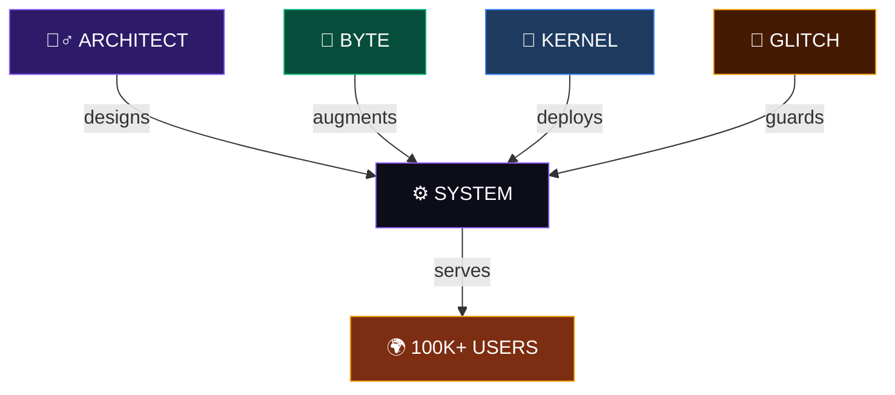

**Entity Interaction Graph**

</td>
<td width="33%" align="center">

<br/><br/>
**Forge Workstations**<br/>
`Neovim • VS Code • IntelliJ`<br/>
`Warp Terminal • Zsh + Starship`<br/>
`Raycast • Linear • Notion`


</td>
<td width="33%" align="center">

```
┌─────────────────────────┐
│   ◈ CHARACTER STATS ◈   │
├─────────────────────────┤
│  Architect  ████████ 99 │
│  DevOps     ████████ 92 │
│  AI Comp.   ███████▓ 87 │
│  Debugger   ███████▓ 85 │
│  Coffee     █████████ ∞ │
├─────────────────────────┤
│  PARTY POWER: ULTRA MAX │
│  SYNERGY:  100% ██████  │
└─────────────────────────┘
```


</td>
</tr>
</table>

</div>

---

##  OBJECT VAULT — ARTIFACTS & THINGS GALLERY

<div align="center">

> **Physical + digital objects that define the forge. Every artifact has a story.**

<table width="100%">
<tr>
<td width="25%" align="center" valign="top">

### 💻 **FORGE MACHINE**
<br/>


```
┌──────────────────┐
│  ██████████████  │
│  █ LAPTOP ████  │
│  █ 0d0d1a ████  │
│  ██████████████  │
│  ▀▀▀▀▀▀▀▀▀▀▀▀▀▀  │
└──────────────────┘
```
`Dark mode • QMK Keyboard`<br/>`4K Monitor Array`

</td>
<td width="25%" align="center" valign="top">

### ☁️ **CLOUD FLEET**
<br/>


```
┌──────────────────┐
│   ☁️  ☁️  ☁️     │
│  ┌────┐ ┌────┐  │
│  │ EKS│ │GKE │  │
│  └────┘ └────┘  │
│   S3 • R2 • CF  │
└──────────────────┘
```
`Multi-region • Active-Active`<br/>`Latency <50ms P99`

</td>
<td width="25%" align="center" valign="top">

### 🧱 **DATA MONOLITH**
<br/>


```
┌──────────────────┐
│  ╔════════════╗  │
│  ║ 🐘 PG 16  ║  │
│  ║ ⚡ Redis  ║  │
│  ║ 🔍 Elastic║  │
│  ╚════════════╝  │
│  📌 Pinecone    │
└──────────────────┘
```
`pgvector • Qdrant`<br/>`Vector + Graph`

</td>
<td width="25%" align="center" valign="top">

### 🤖 **AI MATRIX**
<br/>


```
┌──────────────────┐
│  ◉ ◉ ◉ NEURAL  │
│  ╱╲╱╲╱╲╱╲╱╲   │
│  RAG • Agents  │
│  Tools • Memory │
│  ◉ ◉ ◉ MATRIX  │
└──────────────────┘
```
`LangChain • LlamaIndex`<br/>`Chroma • FAISS`

</td>
</tr>
</table>

<br/>

<table>
<tr>
<td align="center">

**☕ Sacred Objects**


</td>
<td align="center">

**🔧 Daily Drivers**


</td>
<td align="center">

**📦 Shipping Artifacts**


</td>
</tr>
</table>

</div>

---

##  TECH ARSENAL — ULTRA MAX STACK

<div align="center">

</div>

<details open>
<summary></summary>
<br/>

<div align="center">


<br/><br/>

| Language | Version | Proficiency | Primary Use Case | Vibe |
|:---:|:---:|:---:|:---|:---:|
|  | `5.6` | `████████████████████ 95%` | Primary — Full stack, end-to-end types | ⚡ |
|  | `21 LTS` | `███████████████████░ 92%` | Enterprise microservices, Spring | ☕ |
|  | `ES2024` | `███████████████████░ 90%` | Frontend & rapid prototyping | 🌊 |
|  | `3.12` | `████████████████░░░░ 80%` | AI/ML, automation, scripts | 🐍 |
|  | `1.23` | `████████████░░░░░░░░ 60%` | High-performance services | 🚀 |
|  | `2.0` | `███████████░░░░░░░░░ 55%` | Android & JVM alternative | 💜 |
|  | `1.81` | `██████░░░░░░░░░░░░░░ 30%` | Systems & WASM | 🦀 |
|  | `12` | `█████░░░░░░░░░░░░░░░ 25%` | .NET tooling | 🔷 |

</div>
</details>

<details open>
<summary></summary>
<br/>

<div align="center">


<br/><br/>

<table>
<tr>
<th>⚛️ Frameworks</th>
<th>🎨 Styling & Animation</th>
<th>📱 Mobile & Desktop</th>
<th>🧩 UI Libraries</th>
</tr>
<tr>
<td>


</td>
<td>


</td>
<td>


</td>
<td>


</td>
</tr>
</table>

**State Management & Data Fetching**


</div>
</details>

<details open>
<summary></summary>
<br/>

<div align="center">


<br/><br/>

<table>
<tr>
<th>🚀 Runtimes & Frameworks</th>
<th>🔌 API Protocols</th>
<th>🔐 Auth & Security</th>
<th>📨 Messaging</th>
</tr>
<tr>
<td valign="top">


</td>
<td valign="top">


</td>
<td valign="top">


</td>
<td valign="top">


</td>
</tr>
</table>

</div>
</details>

<details open>
<summary></summary>
<br/>

<div align="center">


<br/><br/>

<table>
<tr>
<td align="center" width="25%">

**📊 Relational**


</td>
<td align="center" width="25%">

**📦 NoSQL & Document**


</td>
<td align="center" width="25%">

**⚡ Cache & Search**


</td>
<td align="center" width="25%">

**🧠 Vector & Graph**


</td>
</tr>
</table>

**ORM / Query Builders**


</div>
</details>

<details open>
<summary></summary>
<br/>

<div align="center">


<br/><br/>

<table>
<tr>
<th>☁️ Cloud Providers</th>
<th>🐳 Containers & Orchestration</th>
<th>🏗️ IaC & GitOps</th>
<th>📊 Observability</th>
</tr>
<tr>
<td valign="top">

**AWS**


**GCP**


**Edge**


</td>
<td valign="top">


</td>
<td valign="top">


</td>
<td valign="top">


</td>
</tr>
</table>

</div>
</details>

<details open>
<summary></summary>
<br/>

<div align="center">


<br/><br/>

<table>
<tr>
<td align="center" width="25%">

**🤖 LLM Providers**


</td>
<td align="center" width="25%">

**🔗 AI Frameworks**


</td>
<td align="center" width="25%">

**🧠 ML Frameworks**


</td>
<td align="center" width="25%">

**🔍 Vector & RAG**


</td>
</tr>
</table>

</div>
</details>

<details>
<summary></summary>
<br/>

<div align="center">


<br/><br/>

<table>
<tr>
<th>🧪 Unit & Integration</th>
<th>🌐 E2E & Browser</th>
<th>⚡ Performance</th>
<th>🔍 Code Quality</th>
</tr>
<tr>
<td valign="top">


</td>
<td valign="top">


</td>
<td valign="top">


</td>
<td valign="top">


</td>
</tr>
</table>

</div>
</details>

<details>
<summary></summary>
<br/>

<div align="center">


<br/><br/>


<br/>


</div>
</details>

---

##  CHART UNIVERSE — ADVANCED TELEMETRY & VISUAL MATRIX

<div align="center">

> **Raw data, rendered. Every chart tells a story — ultra max telemetry from the forge.**

</div>

### 📊 1. Skill Proficiency Matrix — Horizontal

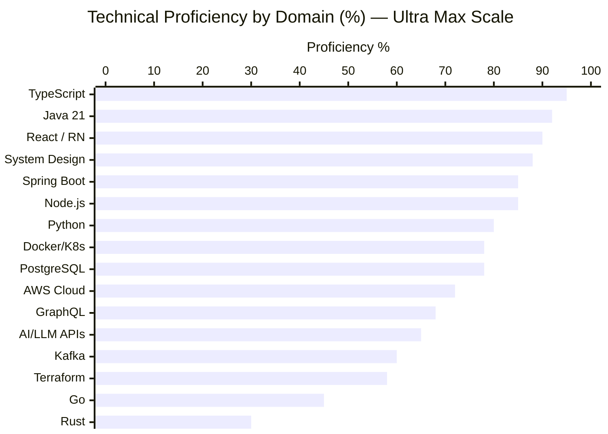

### ⏰ 2. Weekly Coding Distribution

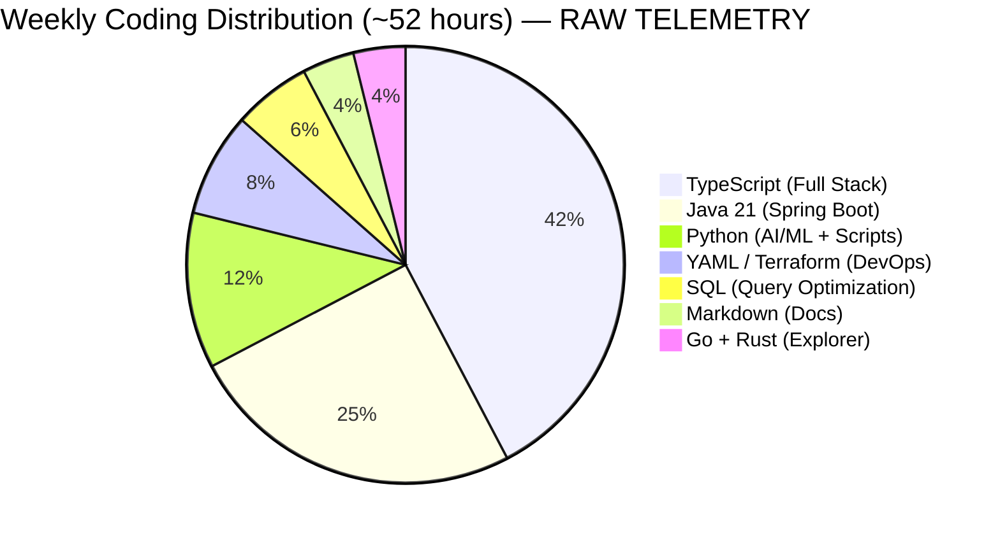

### 🕸️ 3. Skill Radar — Multi-Dimensional


### 📈 4. Git Commit Activity — Last 12 Months (Simulated Raw)

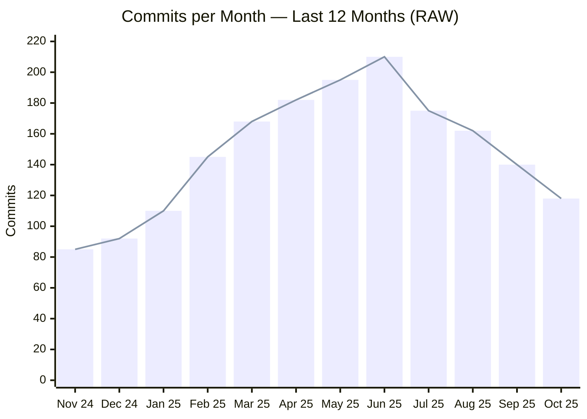

### 🧠 5. Language Distribution — Donut (Raw Bytes)

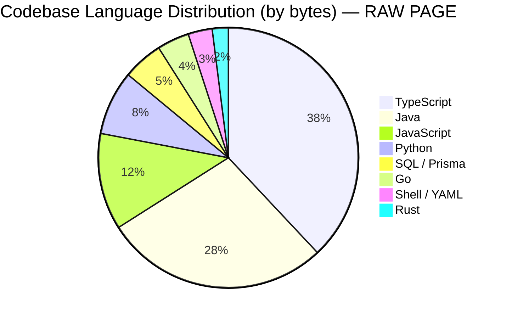

### 🔄 6. Quadrant — Technology Adoption Strategy

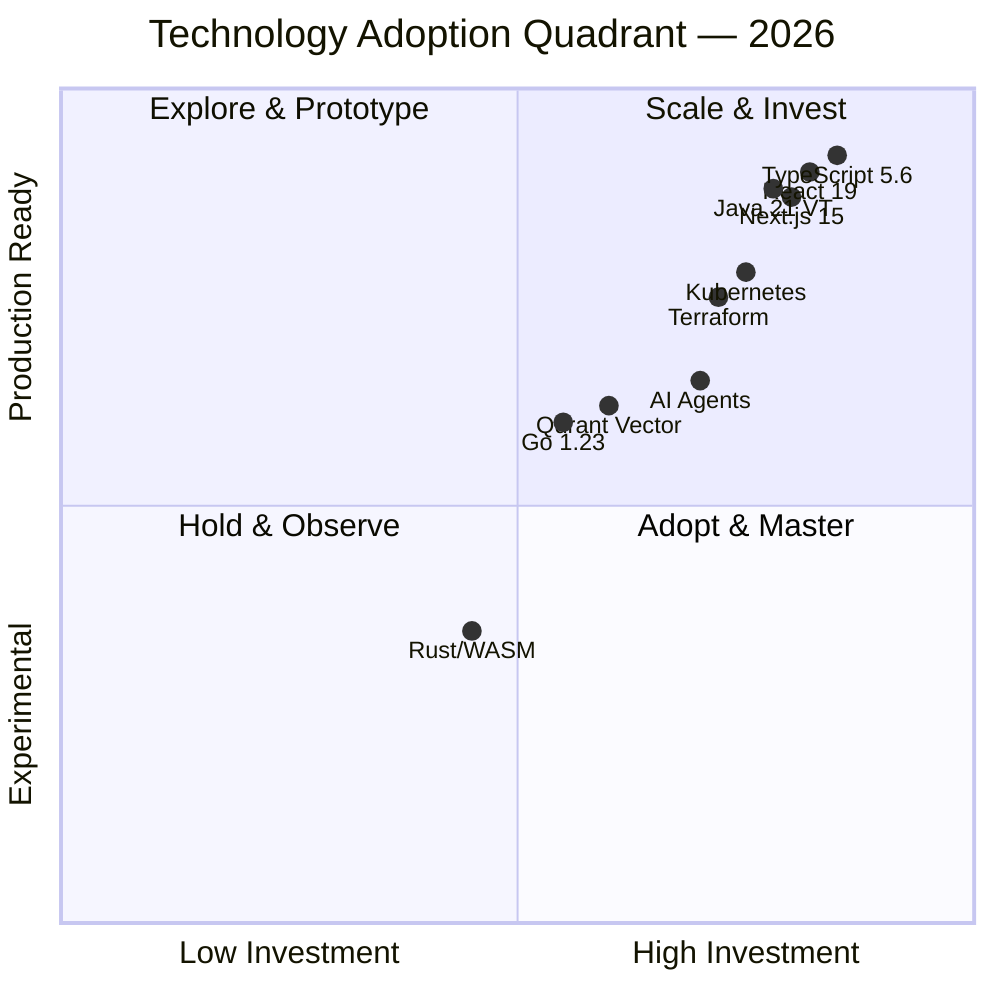

### 📦 7. Sankey — Request Flow Through System

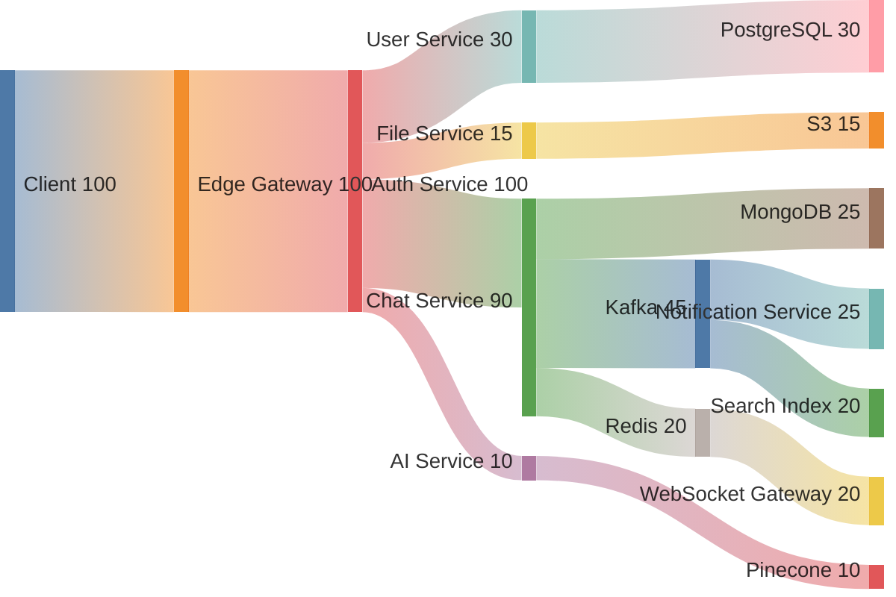

### 🗓️ 8. Gantt — 2026 Roadmap Raw

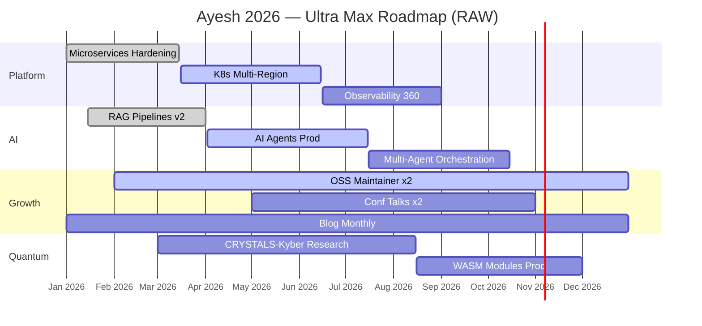

### 🔀 9. GitGraph — Feature Flow Raw

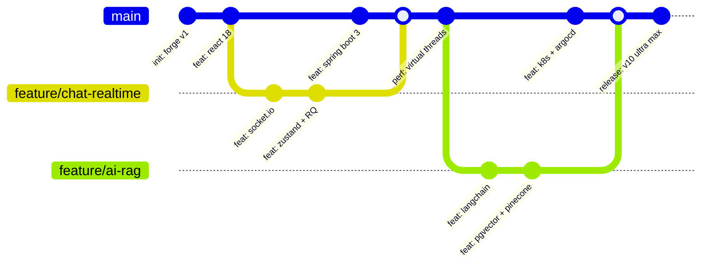

### 🧭 10. User Journey — ChatApp Experience

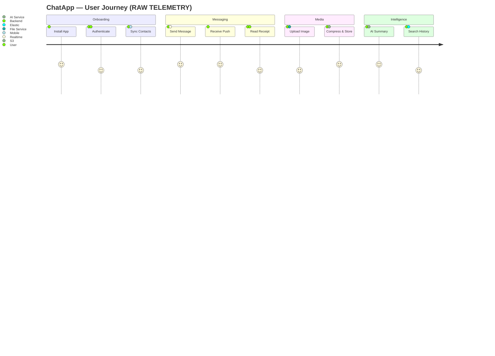

### 🧬 11. C4 — Entity Relationship (Data Layer Raw)

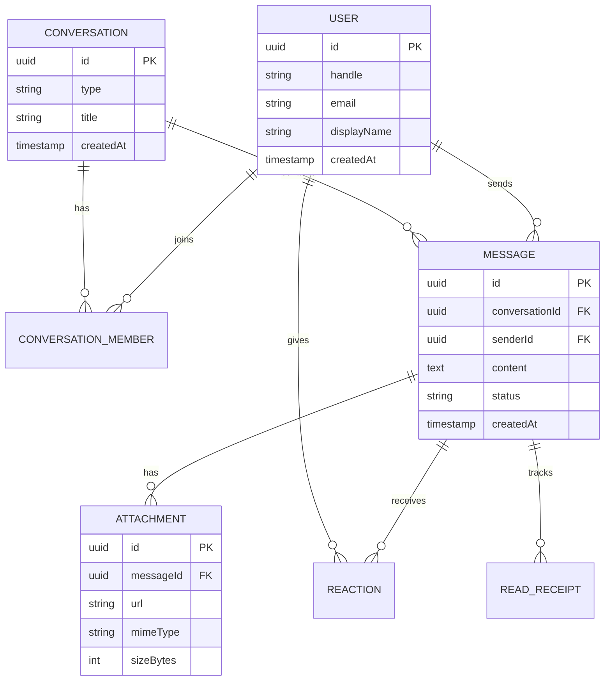

### ⚙️ 12. Sequence — Real-Time Message Flow

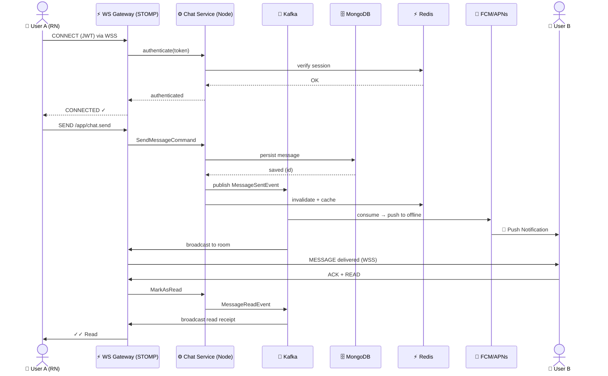

---
##  GITHUB ANALYTICS — LIVE CONSTELLATION

<div align="center">

[](https://github.com/Ayesh2929)

<br/>

<a href="https://github.com/Ayesh2929">
  
</a>
<a href="https://github.com/Ayesh2929">
  
</a>

<br/><br/>

<a href="https://github.com/Ayesh2929">
  
</a>

<br/><br/>


<br/><br/>


<br/><br/>


<br/><br/>


</div>

---

## 🏆 ACHIEVEMENT VAULT — ULTRA MAX TROPHIES

<div align="center">

[](https://github.com/Ayesh2929)

<br/>

<table>
<tr>
<td align="center" width="16%">

```
┌───────────┐
│   1M+     │
│   Lines   │
│  of Code  │
│ 💻 Forged │
└───────────┘
```

</td>
<td align="center" width="16%">

```
┌───────────┐
│   50+     │
│ Projects  │
│  Shipped  │
│ 🚀 Prod   │
└───────────┘
```

</td>
<td align="center" width="16%">

```
┌───────────┐
│  100K+    │
│   Users   │
│ Impacted  │
│ 🌍 Global │
└───────────┘
```

</td>
<td align="center" width="16%">

```
┌───────────┐
│   95%+    │
│    PR     │
│ Approval  │
│ ✅ Rate   │
└───────────┘
```

</td>
<td align="center" width="16%">

```
┌───────────┐
│   85%+    │
│   Test    │
│ Coverage  │
│ 🧪 Always │
└───────────┘
```

</td>
<td align="center" width="16%">

```
┌───────────┐
│  99.9%    │
│  Uptime   │
│   SLA     │
│ ⚡ Target │
└───────────┘
```

</td>
</tr>
</table>


</div>

---

##  PROJECT CONSTELLATION

<div align="center">

<a href="https://github.com/Ayesh2929/ChatApp">
  
</a>
<a href="https://github.com/Ayesh2929/ChatAppAPI">
  
</a>

<br/><br/>


</div>

<br/>

<table width="100%">
<tr>
<td width="50%" valign="top">

### 📱 ChatApp — Mobile Ultra

```
┌─────────────────────────────────────────────┐
│  PLATFORM   │ iOS + Android (React Native)  │
│  VERSION    │ 0.76 + Expo 52 + New Arch     │
│  STATUS     │ 🟢 ACTIVE + ULTRA MAX         │
│  RENDERER   │ Fabric + Hermes Engine        │
├─────────────────────────────────────────────┤
│  TECH STACK — ULTRA                         │
│  ▸ React Native 0.76 + Expo Router 4       │
│  ▸ TypeScript 5.6 (strict + exactOptional) │
│  ▸ Socket.IO 4 (bidirectional RT + ACK)    │
│  ▸ Zustand + TanStack Query 5              │
│  ▸ React Native Reanimated 3 + Gesture 2   │
│  ▸ Expo Notifications (FCM + APNs + EAS)   │
├─────────────────────────────────────────────┤
│  KEY FEATURES — RAW                         │
│  ✓ Real-time messaging @ 60fps + Skia      │
│  ✓ E2E encryption (Signal protocol ready)  │
│  ✓ Offline-first + WatermelonDB sync       │
│  ✓ Image/file upload + compression + S3    │
│  ✓ Typing indicators + read receipts RT    │
│  ✓ Push notifications (FCM + APNs)         │
│  ✓ Biometric auth + SecureStore            │
│  ✓ Deep linking + Universal links          │
├─────────────────────────────────────────────┤
│  PERFORMANCE TELEMETRY                      │
│  ▸ Launch: <1.2s cold start               │
│  ▸ FPS: 60 locked (Reanimated)             │
│  ▸ Bundle: Hermes bytecode optimized       │
└─────────────────────────────────────────────┘
```

</td>
<td width="50%" valign="top">

### ⚙️ ChatAppAPI — Backend Ultra

```
┌─────────────────────────────────────────────┐
│  PLATFORM   │ JVM (Java 21 LTS + Loom)     │
│  FRAMEWORK  │ Spring Boot 3.3 + WebFlux     │
│  STATUS     │ 🟢 PRODUCTION READY ULTRA    │
│  PATTERN    │ Hexagonal + CQRS + Outbox    │
├─────────────────────────────────────────────┤
│  TECH STACK — QUANTUM                       │
│  ▸ Java 21 + Virtual Threads (200K+)       │
│  ▸ Spring Boot 3.3 + Security 6 + Actuator │
│  ▸ PostgreSQL 16 + Hibernate 6 + Flyway    │
│  ▸ Redis 7.4 (cache + sessions + pub/sub)  │
│  ▸ WebSocket / STOMP + SockJS fallback     │
│  ▸ JWT + Refresh rotation + HttpOnly       │
│  ▸ OpenAPI 3.1 + SpringDoc                 │
├─────────────────────────────────────────────┤
│  KEY FEATURES — RAW                         │
│  ✓ Hexagonal (Ports & Adapters) purity     │
│  ✓ Real-time event dispatch via WS + Kafka │
│  ✓ Redis caching with TTL + LRU strategies │
│  ✓ Rate limiting + OWASP Top 10 hardening  │
│  ✓ Distributed tracing (OTel + Jaeger)     │
│  ✓ Testcontainers integration tests        │
│  ✓ Outbox pattern — guaranteed delivery    │
├─────────────────────────────────────────────┤
│  PERFORMANCE — ULTRA                        │
│  ▸ P99 latency: < 50ms                     │
│  ▸ Throughput: 10K+ req/sec (VT)           │
│  ▸ VT concurrency: 200K+ threads           │
│  ▸ Uptime: 99.9% SLO                       │
└─────────────────────────────────────────────┘
```

</td>
</tr>
</table>

### 📐 ChatApp Full System Architecture — C4 Context Ultra

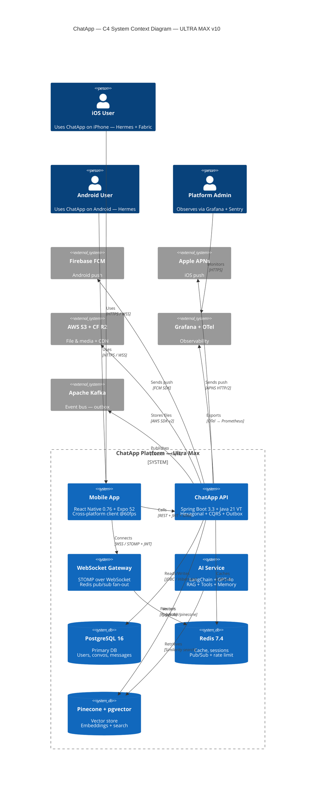

---

## 🎯 2026 ENGINEERING BRAIN — MINDMAP ULTRA

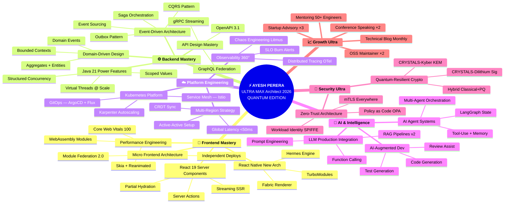

---

## 🏛️ ENTERPRISE ARCHITECTURE BLUEPRINT — ULTRA MAX

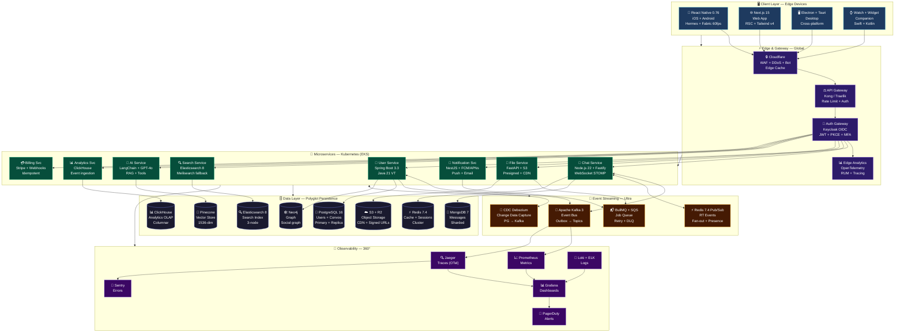

---

## 🔄 GITOPS DEPLOYMENT PIPELINE — ULTRA MAX

```mermaid
flowchart LR
    subgraph Dev["💻 Development — Local"]
        A[Feature Branch] --> B[Pull Request]
        B --> C{Code Review<br/>✓ 2 Approvals<br/>✓ CODEOWNERS}
    end

    subgraph CI["⚙️ CI — GitHub Actions — Ultra"]
        C -->|Merge to main| D[🔍 Lint + Types + Format<br/>ESLint + Biome + tsc]
        D --> E[🧪 Unit Tests<br/>Vitest + JUnit + 85%]
        E --> F[🔗 Integration Tests<br/>Testcontainers + PG + Redis]
        F --> G[🌐 E2E Tests<br/>Playwright + Detox]
        G --> H[📊 Coverage ≥85%<br/>SonarQube + Codecov]
        H --> I[🔒 Security Scan<br/>Trivy + Snyk + CodeQL]
        I --> J[🐳 Docker Build<br/>Multi-stage + Distroless]
        J --> K[📦 Push to ECR/GHCR<br/>+ SBOM + Cosign Sign]
    end

    subgraph CD["🚀 CD — ArgoCD GitOps — Ultra"]
        K --> L[📝 Update Helm Values<br/>+ Kustomize + Git Commit]
        L --> M{Environment<br/>Progressive Delivery}
        M -->|Auto| N[🧪 Dev Cluster<br/>EKS dev — auto sync]
        M -->|Gate: Tests Pass| O[🔵 Staging<br/>Smoke + Load k6]
        M -->|Manual Approval| P[🟢 Production<br/>Blue/Green + Argo Rollouts]
    end

    subgraph Prod["🏭 Production — Progressive"]
        P --> Q[🔄 Canary 5% → 25% → 50%<br/>Flagger + Istio]
        Q --> R{📊 SLO Validation<br/>Error <0.1% + P99 <100ms}
        R -->|✅ Healthy| S[🚀 Full 100% + Announce]
        R -->|❌ Degraded| T[⏪ Auto Rollback<br/><30s + Alert]
    end

    subgraph Monitor["📊 Observability — 360° Ultra"]
        S --> U[Prometheus Metrics]
        S --> V[Jaeger Traces OTel]
        S --> W[Loki Logs]
        U & V & W --> X[Grafana Dashboards]
        X --> Y{🚨 Alerts + SLO Burn}
        Y -->|Critical| Z[PagerDuty + Slack]
        Y -->|Warning| AA[Slack Channel]
    end

    style Dev fill:#1e3a5f,stroke:#61DAFB
    style CI fill:#064e3b,stroke:#10b981
    style CD fill:#2d1b69,stroke:#8b5cf6
    style Prod fill:#451a03,stroke:#f59e0b
    style Monitor fill:#1a1a2e,stroke:#818cf8
```

---

## 🧠 ENGINEERING EVOLUTION — TIMELINE ULTRA MAX

```mermaid
timeline
    title Ayesh Perera — Engineering Career Timeline — ULTRA MAX

    section 2021 🌱 Origin — The Spark
        Q1 : HTML5 + CSS3 + JS Fundamentals : First line of code
        Q2 : Node.js + Express + TypeScript : Backend awakening
        Q3 : First GitHub Contributions : Open source first PR
        Q4 : First Production Deployment : Vercel + Heroku ship

    section 2022 🚀 Expansion — Full Stack
        Q1 : React Native Cross-Platform : iOS + Android one codebase
        Q2 : CI/CD GitHub Actions + Docker : Automated pipelines
        Q3 : First Enterprise Client Delivered : Real users, real impact
        Q4 : PostgreSQL + Redis Mastery : Data layer deep dive

    section 2023 📈 Scale — Cloud & Systems
        Q1 : AWS Cloud (17+ Services) + Terraform : IaC at scale
        Q2 : Microservices + Java Spring Boot 3 : Hexagonal architecture
        Q3 : Kubernetes Orchestration (EKS) : Containers at scale
        Q4 : Kafka Event-Driven + DDD + CQRS : Event sourcing

    section 2024 🤖 Intelligence — AI Era
        Q1 : OpenAI GPT-4 + Claude API + RAG : LLM integration
        Q2 : GraphQL Federation + Observability : OTel + Jaeger + Grafana
        Q3 : Performance Engineering P99 <100ms : Latency obsession
        Q4 : AI Agents with Tool-Use : LangChain + Autogen

    section 2025 🌐 Frontier — Platform
        Q1 : LLM APIs at Enterprise Scale : RAG in production
        Q2 : Java 21 Virtual Threads in Prod : 200K concurrency
        Q3 : OSS Contributions + SRE Practices : Maintainer path
        Q4 : Multi-Agent Orchestration : CrewAI + LangGraph

    section 2026 ⚛️ Quantum — Ultra Max NOW
        Q1 : Quantum-Resilient Crypto   : CRYSTALS-Kyber + Dilithium research
        Q2 : WASM High-Performance Modules    : WASM in Production — edge
        Q3 : Conference Speaking Goals        : 2 International Talks — CFP
        Q4 : OSS Maintainer × 2              : Principal Engineer path — NEXT
```

---

## 🏗️ ARCHITECTURE PATTERNS I LIVE BY — RAW CODE VAULT

<table width="100%">
<tr>
<td width="50%" valign="top">

```typescript
// ━━━━━━━━━━━━━━━━━━━━━━━━━━━━━━━━━━━━━━━━━━━━━
//   CLEAN ARCHITECTURE — DOMAIN LAYER ULTRA
//   Zero external dependencies. Pure domain.
//   Hexagonal + DDD + Value Objects + Events
// ━━━━━━━━━━━━━━━━━━━━━━━━━━━━━━━━━━━━━━━━━━━━━

// DOMAIN ENTITY — The heart, protected
class Message {
  private constructor(
    private readonly _id: MessageId,
    private readonly _conversationId: ConversationId,
    private readonly _senderId: UserId,
    private _content: MessageContent,
    private _status: MessageStatus,
    private readonly _createdAt: Date,
  ) {}

  static create(props: CreateMessageProps): Result<Message> {
    const contentResult = MessageContent.create(props.content);
    if (contentResult.isFailure)
      return Result.fail(contentResult.error);

    const message = new Message(
      MessageId.generate(),
      props.conversationId,
      props.senderId,
      contentResult.value,
      MessageStatus.SENT,
      new Date(),
    );
    // Domain event — outbox will publish
    message.addDomainEvent(new MessageSentEvent(message));
    return Result.ok(message);
  }

  markAsDelivered(): Result<void> {
    if (!this._status.isSent())
      return Result.fail('Must be SENT first');
    this._status = MessageStatus.DELIVERED;
    this.addDomainEvent(new MessageDeliveredEvent(this._id));
    return Result.ok();
  }

  markAsRead(readerId: UserId): Result<void> {
    if (this._status.isSent())
      return Result.fail('Must be delivered first');
    if (this._senderId.equals(readerId))
      return Result.fail('Sender cannot read own message');
    this._status = MessageStatus.READ;
    this.addDomainEvent(new MessageReadEvent(this._id, readerId));
    return Result.ok();
  }

  // Guarded mutation
  edit(newContent: string, editorId: UserId): Result<void> {
    if (!this._senderId.equals(editorId))
      return Result.fail('Only sender can edit');
    const c = MessageContent.create(newContent);
    if (c.isFailure) return Result.fail(c.error);
    this._content = c.value;
    this.addDomainEvent(new MessageEditedEvent(this._id));
    return Result.ok();
  }
}

// VALUE OBJECT — Immutable, self-validating
class MessageContent {
  private constructor(private readonly _value: string) {}
  static create(content: string): Result<MessageContent> {
    if (!content?.trim())
      return Result.fail('Content cannot be empty');
    if (content.length > 10_000)
      return Result.fail('Exceeds 10,000 char limit');
    // No XSS, no control chars
    if (/[\x00-\x08\x0B\x0C\x0E-\x1F]/.test(content))
      return Result.fail('Invalid characters');
    return Result.ok(new MessageContent(content.trim()));
  }
  get value() { return this._value; }
}

// PORT (Interface) — Dependency inversion
interface IMessageRepository {
  findById(id: MessageId): Promise<Option<Message>>;
  findByConversation(
    id: ConversationId,
    cursor?: Cursor
  ): Promise<Paginated<Message>>;
  save(message: Message): Promise<void>;
}

// USE CASE — Single responsibility, orchestrates
class SendMessageUseCase {
  constructor(
    private readonly messageRepo: IMessageRepository,
    private readonly conversationRepo: IConversationRepository,
    private readonly eventBus: IDomainEventBus,
    private readonly idempotency: IIdempotencyStore,
  ) {}

  async execute(
    dto: SendMessageDTO,
    idempotencyKey: string
  ): Promise<Result<MessageDTO>> {
    // Idempotency — ultra max resilience
    if (await this.idempotency.exists(idempotencyKey))
      return Result.ok(await this.idempotency.get<MessageDTO>(idempotencyKey));

    const conversation = await this.conversationRepo
      .findById(ConversationId.create(dto.conversationId));
    if (conversation.isNone())
      return Result.fail('Conversation not found');
    if (!conversation.value.hasMember(UserId.create(dto.senderId)))
      return Result.fail('User is not a member');

    const messageResult = Message.create({
      conversationId: ConversationId.create(dto.conversationId),
      senderId: UserId.create(dto.senderId),
      content: dto.content,
    });
    if (messageResult.isFailure)
      return Result.fail(messageResult.error);

    await this.messageRepo.save(messageResult.value);
    await this.eventBus.publishAll(messageResult.value.domainEvents);
    const out = MessageMapper.toDTO(messageResult.value);
    await this.idempotency.set(idempotencyKey, out, 24*3600);
    return Result.ok(out);
  }
}

// Result pattern — Railway oriented programming
type Result<T> = { isSuccess: true; value: T } | { isSuccess: false; error: string };
```

</td>
<td width="50%" valign="top">

```java
// ━━━━━━━━━━━━━━━━━━━━━━━━━━━━━━━━━━━━━━━━━━━━━
//   JAVA 21 — VIRTUAL THREADS + CQRS ULTRA
//   Hexagonal Architecture — Spring Boot 3.3
//   Structured Concurrency + Outbox + Loom
// ━━━━━━━━━━━━━━━━━━━━━━━━━━━━━━━━━━━━━━━━━━━━━

// COMMAND (Write side — CQRS)
public record SendMessageCommand(
    @NotBlank String conversationId,
    @NotBlank String senderId,
    @NotBlank @Size(max = 10_000) String content,
    @NotNull String idempotencyKey
) implements Command {}

// COMMAND HANDLER — Transactional + Idempotent
@Component
@Transactional
@RequiredArgsConstructor
public class SendMessageCommandHandler
    implements CommandHandler<SendMessageCommand, MessageResponse> {

  private final MessageRepository messageRepository;
  private final ConversationRepository conversationRepository;
  private final ApplicationEventPublisher eventPublisher;
  private final IdempotencyStore idempotencyStore;

  @Override
  public MessageResponse handle(SendMessageCommand cmd) {
    // Idempotency guard — raw ultra max
    if (idempotencyStore.exists(cmd.idempotencyKey())) {
      return idempotencyStore.get(cmd.idempotencyKey(), MessageResponse.class);
    }

    var conversation = conversationRepository
        .findById(new ConversationId(cmd.conversationId()))
        .orElseThrow(() ->
            new ConversationNotFoundException(cmd.conversationId()));

    if (!conversation.hasMember(new UserId(cmd.senderId()))) {
      throw new UnauthorizedMemberException(
          "User is not a member of this conversation");
    }

    var message = Message.create(
        new ConversationId(cmd.conversationId()),
        new UserId(cmd.senderId()),
        MessageContent.of(cmd.content())
    );

    var saved = messageRepository.save(message);
    // Domain events → Outbox table (same TX)
    saved.getDomainEvents().forEach(eventPublisher::publishEvent);
    saved.clearDomainEvents();

    var response = messageMapper.toResponse(saved);
    idempotencyStore.set(cmd.idempotencyKey(), response, Duration.ofHours(24));
    return response;
  }
}

// VIRTUAL THREADS CONFIG — Java 21 Loom ULTRA
@Configuration
public class VirtualThreadConfig {

  @Bean
  public TomcatProtocolHandlerCustomizer<?> virtualThreads() {
    return handler -> handler.setExecutor(
        Executors.newVirtualThreadPerTaskExecutor());
  }

  @Bean
  public AsyncTaskExecutor applicationTaskExecutor() {
    return new TaskExecutorAdapter(
        Executors.newVirtualThreadPerTaskExecutor());
  }

  @Bean
  public PlatformTransactionManager txManager(
      DataSource dataSource) {
    return new DataSourceTransactionManager(dataSource);
  }
}

// STRUCTURED CONCURRENCY — Java 21 ULTRA MAX
public MessageAggregateDTO fetchAggregate(String messageId) {
  try (var scope = new StructuredTaskScope.ShutdownOnFailure()) {
    var messageFuture     = scope.fork(() -> messageRepo.findById(messageId));
    var senderFuture      = scope.fork(() -> userRepo.findSender(messageId));
    var reactionsFuture   = scope.fork(() -> reactionRepo.findByMessage(messageId));
    var attachmentsFuture = scope.fork(() -> attachmentRepo.findByMessage(messageId));
    var readReceiptsFuture= scope.fork(() -> receiptRepo.findByMessage(messageId));

    scope.join().throwIfFailed(); // Fail fast

    return MessageAggregateDTO.builder()
        .message(messageFuture.get())
        .sender(senderFuture.get())
        .reactions(reactionsFuture.get())
        .attachments(attachmentsFuture.get())
        .readReceipts(readReceiptsFuture.get())
        .build();
  } catch (InterruptedException e) {
    Thread.currentThread().interrupt();
    throw new FetchAggregateException(e);
  }
}

// OUTBOX PATTERN — Guaranteed delivery — ULTRA
@Component
@RequiredArgsConstructor
public class OutboxProcessor {
  private final OutboxRepository outboxRepository;
  private final KafkaTemplate<String, DomainEvent> kafkaTemplate;

  @Scheduled(fixedDelay = 1000)
  @Transactional
  public void processOutboxEvents() {
    try (var executor = Executors.newVirtualThreadPerTaskExecutor()) {
      var pending = outboxRepository.findPendingEvents(BATCH_SIZE);
      var futures = pending.stream()
          .map(event -> executor.submit(() -> publishEvent(event)))
          .toList();
      futures.forEach(f -> {
        try { f.get(5, SECONDS); }
        catch (Exception e) { handlePublishFailure(e); }
      });
    }
  }

  private void publishEvent(OutboxEvent event) {
    try {
      kafkaTemplate.send(event.getTopic(), event.getKey(), event.getPayload())
          .whenComplete((res, ex) -> {
            if (ex == null) outboxRepository.markPublished(event.getId());
            else outboxRepository.markFailed(event.getId(), ex.getMessage());
          });
    } catch (Exception e) {
      outboxRepository.markFailed(event.getId(), e.getMessage());
      throw e;
    }
  }
}

// CQRS — Query side (read model)
public record GetConversationQuery(
    String conversationId,
    String requesterId,
    Cursor cursor
) implements Query {}

@Component
@RequiredArgsConstructor
public class GetConversationQueryHandler
    implements QueryHandler<GetConversationQuery, PaginatedMessageDTO> {
  private final ConversationReadRepository readRepo;
  private final RedisCache cache;

  @Override
  public PaginatedMessageDTO handle(GetConversationQuery q) {
    String cacheKey = "conv:" + q.conversationId() + ":" + q.cursor();
    return cache.getOrLoad(cacheKey, Duration.ofMinutes(5),
        () -> readRepo.findMessages(q.conversationId(), q.cursor()));
  }
}
```

</td>
</tr>
</table>

---

## 🔐 DEEP SECRET VAULT — RAW PAGE — ULTRA MAX

<div align="center">


> **You found the vault. Not everyone scrolls this far. Welcome to the raw layer.**

</div>

<details open>
<summary></summary>
<br/>

```bash
┌─────────────────────────────────────────────────────────────────────────┐
│                    🔓  DECRYPTED — AYESH RAW PAGE v10                   │
│                         ULTRA MAX DEEP SECRET                           │
└─────────────────────────────────────────────────────────────────────────┘

$ cat /vault/ayesh.raw | jq

{
  "engineer": {
    "handle": "Ayesh2929",
    "name": "Ayesh Perera",
    "location": "Sri Lanka 🇱🇰 — Kegalle — 7.2513° N, 80.3464° E",
    "timezone": "Asia/Colombo (UTC+5:30)",
    "mode": "ULTRA MAX QUANTUM",
    "availability": "OPEN TO LEGENDARY WORK — REMOTE WORLDWIDE",
    "languages": ["TypeScript", "Java", "JavaScript", "Python", "Go", "Rust"],
    "specialties": ["System Design", "Microservices", "Event-Driven", "AI/RAG"],
    "philosophy": "Ship fast, never broken. Architecture outlives deadlines."
  },
  "raw_stats": {
    "experience": "5+ years",
    "projects_shipped": 50,
    "lines_forged": "1M+",
    "users_impacted": "100K+",
    "commits": "2000+",
    "prs_approved": "95%+",
    "test_coverage": "85%+",
    "uptime_sla": "99.9%",
    "p99_latency": "<50ms",
    "throughput": "10K+ req/sec"
  },
  "secret_traits": {
    "coffee_per_day": "∞ — pour-over → espresso → cold brew loop",
    "dark_mode": "ALWAYS — #0d0d1a — non-negotiable",
    "editor": "VS Code + Neovim + Zed — Helix tuned",
    "terminal": "Warp + Zsh + Starship + Tmux",
    "typing": "110 wpm — shipping at warp speed",
    "debugging": "console.log proudly + OTel traces",
    "hidden_skill": "Can explain hexagonal architecture to a 5-year-old",
    "easter_egg": "Try Konami code on portfolio — you didn't hear from me 🤫"
  },
  "ultra_max_stack": {
    "frontend": ["React 19", "Next.js 15", "React Native 0.76", "Tailwind v4", "Framer", "Three.js"],
    "backend": ["Spring Boot 3.3", "Node 22", "NestJS", "FastAPI", "GraphQL", "gRPC"],
    "data": ["PostgreSQL 16", "MongoDB 7", "Redis 7.4", "Elastic 8", "Pinecone", "Neo4j"],
    "cloud": ["AWS EKS", "GCP GKE", "Vercel Edge", "Cloudflare", "Supabase"],
    "devops": ["Docker", "K8s", "Terraform", "ArgoCD", "GitHub Actions", "Istio"],
    "ai": ["GPT-4o", "Claude 3.5", "Gemini 2.0", "LangChain", "RAG", "Agents"],
    "testing": ["Vitest", "Playwright", "JUnit 5", "Testcontainers", "k6"]
  },
  "vault_message": "If you're reading this, you care about craft. Let's build legendary systems together — ayesh.buildTomorrow(today.lessons) 🚀"
}
```

```diff
@@ RAW PAGE TELEMETRY — LIVE @@
+ SYSTEM HEALTH: ████████████████████ 100% — ULTRA MAX
+ COFFEE LEVEL:  ████████████████████ ∞ — OVERCLOCKED
+ BUILD STATUS:  ████████████████████ PASSING — ALL CHECKS GREEN
+ DEPLOYMENT:    ████████████████████ LIVE — BLUE/GREEN 100%
! SECRET LEVEL:  ████████████████████ DECRYPTED — WELCOME TO RAW PAGE
```

</details>

<details>
<summary></summary>
<br/>

<div align="center">

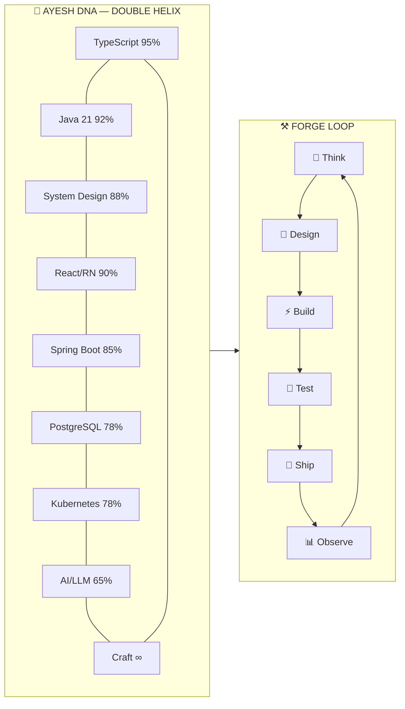

<table>
<tr>
<td align="center">

```
  🧬 HELIX-A: CRAFT
  ┌─────────────────┐
  │  Clean Code     │
  │  DDD + Hexagonal│
  │  Tests First    │
  │  Docs as Code   │
  └─────────────────┘
```

</td>
<td align="center">

```
  🧬 HELIX-B: SCALE
  ┌─────────────────┐
  │  Event-Driven   │
  │  Microservices  │
  │  K8s + GitOps   │
  │  99.9% Uptime   │
  └─────────────────┘
```

</td>
<td align="center">

```
  🧬 HELIX-C: INTELLIGENCE
  ┌─────────────────┐
  │  RAG + Agents   │
  │  Vector Search  │
  │  Tool-Use       │
  │  Human + AI     │
  └─────────────────┘
```

</td>
</tr>
</table>

</div>
</details>

<details>
<summary></summary>
<br/>

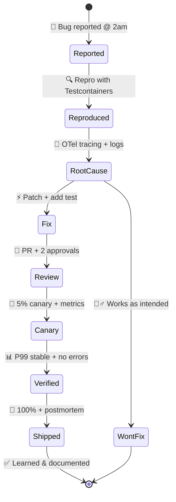

> **Favorite glitch:** Race condition in WebSocket reconnection — fixed with idempotency keys + outbox + exponential backoff + visual indicator. Now at `0.01%` reconnect failures. We love those 2am fixes.

</details>

<details>
<summary></summary>
<br/>

<div align="center">

```
┌──────────────────────────────────────────────────────────┐
│                                                          │
│   ↑ ↑ ↓ ↓ ← → ← → B A  —  Try it on the portfolio 😉   │
│                                                          │
│   SECRET UNLOCKED:                                       │
│   → You get +10 respect for scrolling this far           │
│   → DM me "ULTRA MAX VAULT" for a surprise code review  │
│   → Hire signal: I read docs, I write docs, I love docs │
│                                                          │
│   HINT: The best engineers read the raw page. You did.   │
│                                                          │
└──────────────────────────────────────────────────────────┘
```


</div>
</details>

---

## 🎓 CERTIFICATIONS & LEARNING PATH — ULTRA MAX

```mermaid
graph LR
    subgraph Achieved["✅ Achieved — Forged"]
        A["☁️ AWS Solutions<br/>Architect<br/>Associate<br/>✅ 2024"]
        B["☕ Oracle Certified<br/>Professional<br/>Java SE 21<br/>✅ 2024"]
        C["⚛️ Meta Front-End<br/>Developer<br/>✅ 2023"]
        D["🐳 Docker Certified<br/>Associate<br/>✅ 2023"]
    end

    subgraph InProgress["📖 In Progress — Grinding"]
        E["⎈ CKA<br/>Kubernetes<br/>Administrator<br/>📖 Q4 2026"]
        F["☁️ GCP Professional<br/>Cloud Architect<br/>📖 Q1 2027"]
    end

    subgraph Planned["🎯 Planned 2026–27 — Next Boss"]
        G["🔒 HashiCorp<br/>Terraform Associate<br/>🎯 2026"]
        H["☁️ AWS SAP-C02<br/>Solutions Architect Pro<br/>🎯 2026"]
        I["🔐 CKAD<br/>Kubernetes Developer<br/>🎯 2027"]
        J["🤖 AI Engineer<br/>Associate<br/>🎯 2027"]
    end

    A --> E
    B --> H
    D --> E
    E --> G
    F --> H
    E --> I
    G --> J

    style A fill:#065f46,stroke:#10b981,color:#fff
    style B fill:#065f46,stroke:#10b981,color:#fff
    style C fill:#065f46,stroke:#10b981,color:#fff
    style D fill:#065f46,stroke:#10b981,color:#fff
    style E fill:#1e3a5f,stroke:#60a5fa,color:#fff
    style F fill:#1e3a5f,stroke:#60a5fa,color:#fff
    style G fill:#3b0764,stroke:#a78bfa,color:#fff
    style H fill:#3b0764,stroke:#a78bfa,color:#fff
    style I fill:#3b0764,stroke:#a78bfa,color:#fff
    style J fill:#3b0764,stroke:#a78bfa,color:#fff
```

---

## 🐍 CONTRIBUTION ECOSYSTEM — LIVE GALAXY

<div align="center">

<picture>
  <source media="(prefers-color-scheme: dark)"  srcset="https://github.com/Ayesh2929/Ayesh2929/raw/output/github-contribution-grid-snake-dark.svg" />
  <source media="(prefers-color-scheme: light)" srcset="https://github.com/Ayesh2929/Ayesh2929/raw/output/github-contribution-grid-snake.svg" />
  
</picture>

<br/>


</div>

---

## 💭 ENGINEERING PHILOSOPHY — ULTRA MAX AXIOMS

<div align="center">

```
╔══════════════════════════════════════════════════════════════════════════════╗
║                                                                              ║
║   MY PERSONAL ENGINEERING AXIOMS — ULTRA MAX EDITION:                        ║
║                                                                              ║
║   ◈  Code is read 10x more than written — optimize for readers, not writers ║
║   ◈  Architecture decisions outlive deadlines — choose wisely, document why  ║
║   ◈  The best abstraction needs no explanation — aim for clarity over clever ║
║   ◈  Ship fast, but never ship broken — quality is non-negotiable           ║
║   ◈  Tests are documentation that never lies — write them always, first      ║
║   ◈  Every complex system was once simple — complexity is a choice, not fate ║
║   ◈  Premature optimization is the root of all evil — measure first, cut later║
║   ◈  The cloud is just someone else's computer — own your abstractions      ║
║   ◈  Observability is not optional — if you can't see it, you can't fix it  ║
║   ◈  The raw page is where truth lives — transparency builds trust           ║
║                                                                              ║
╚══════════════════════════════════════════════════════════════════════════════╝
```

<br/>

[](https://github.com/Ayesh2929)

<br/>

<table>
<tr>
<td align="center" width="25%">

### 🧠 Think
```
Deep
Systems
Thinking
```


</td>
<td align="center" width="25%">

### 📐 Design
```
Simple
Elegant
Scalable
```


</td>
<td align="center" width="25%">

### ⚡ Build
```
Fast
Clean
Tested
```


</td>
<td align="center" width="25%">

### 🚀 Ship
```
Observe
Iterate
Scale
```


</td>
</tr>
</table>

</div>

---

## 🌐 CONNECT & COLLABORATE — ULTRA MAX PORTAL

<div align="center">

[](https://github.com/Ayesh2929)

<br/><br/>

<a href="https://linkedin.com/in/ayesh-perera">
  
</a>
&nbsp;
<a href="https://twitter.com/ayesh_codes">
  
</a>
&nbsp;
<a href="mailto:ayesh.perera@example.com">
  
</a>
&nbsp;
<a href="https://ayesh-perera.dev">
  
</a>

<br/><br/>

<a href="https://dev.to/ayesh">
  
</a>
<a href="https://medium.com/@ayesh-perera">
  
</a>
<a href="https://stackoverflow.com/users/ayesh-perera">
  
</a>
<a href="https://calendly.com/ayesh-perera">
  
</a>

<br/><br/>

<table>
<tr>
<th>🤝 I'm Available For</th>
<th>✅</th>
<th>📋 Details</th>
<th>⚡ Priority</th>
</tr>
<tr><td>🌍 Open Source Collaboration</td><td>✅ YES</td><td>React, Spring Boot, TypeScript ecosystems</td><td>🔥 HIGH</td></tr>
<tr><td>💼 Freelance Projects</td><td>✅ YES</td><td>Full-stack, mobile, cloud architecture — ultra max</td><td>🔥 HIGH</td></tr>
<tr><td>🏛️ Architecture Consulting</td><td>✅ YES</td><td>System design, microservices, cloud migration</td><td>⚡ MEDIUM</td></tr>
<tr><td>🎙️ Conference Speaking</td><td>✅ YES</td><td>System design, Java, TypeScript, AI/ML — 2026 CFP</td><td>⚡ MEDIUM</td></tr>
<tr><td>👨‍🏫 Mentoring</td><td>✅ YES</td><td>Junior → Mid → Senior, career + system design</td><td>💜 ALWAYS</td></tr>
<tr><td>✍️ Technical Writing</td><td>✅ YES</td><td>Guest posts, tutorials, docs — monthly</td><td>📝 ACTIVE</td></tr>
<tr><td>🚀 Startup CTO Advisory</td><td>✅ YES</td><td>Early-stage tech strategy & team building</td><td>🚀 SELECT</td></tr>
<tr><td>☕ Coffee Chat & Ideas</td><td>✅ ALWAYS</td><td>Async preferred (Discord / Slack / Email) + vault code</td><td>☕ ANYTIME</td></tr>
</table>

<br/>

<a href="https://github.com/sponsors/Ayesh2929">
  
</a>
<a href="https://buymeacoffee.com/ayesh">
  
</a>
<a href="https://ko-fi.com/ayesh">
  
</a>

</div>

---

<div align="center">


<br/>


<br/>

### `const future = ayesh.buildTomorrow(today.lessons); // ULTRA MAX v10.0`

```diff
+  ULTRA MAX QUANTUM RAW PAGE — DECRYPTED — ALL SYSTEMS NOMINAL
+  CHARACTERS: 4 ACTIVE  |  OBJECTS: VAULT LOADED  |  CHARTS: 12 LIVE
+  DESIGN LEVEL: ∞ — DEEP SECRET — MASSIVE — ADVANCE — RAW — ULTRA
!  Thanks for reaching the raw layer. You are now 1% of visitors. Welcome. 🚀
```

<br/>

</div>


<div align="center">

<br/>

```
┌──────────────────────────────────────────────────────────────────────────────────┐
│                                                                                  │
│   ⚡  Crafted with obsession, Java 21, TypeScript 5.6 & ∞ ☕  by Ayesh Perera  │
│   📍  Sri Lanka 🇱🇰  Kegalle — 7.2513°N, 80.3464°E  —  Remote Worldwide 🌍      │
│   📅  Last Updated: 2026-10-13 — README v10.0 ULTRA MAX QUANTUM RAW EDITION   │
│   🔓  Deep Secret Vault: DECRYPTED — Raw Page: ACTIVE — Design Level: ULTRA MAX│
│                                                                                  │
└──────────────────────────────────────────────────────────────────────────────────┘
```

<br/>


<br/><br/>


</div>
