<!--
  Ayesh Perera · GitHub profile README
  Visuals are kept as local assets so the page does not depend on remote art hosts.
-->

<div align="center">


<br />

<code>PERSONAL PROJECT ARCHIVE · AY-29 · BUILDING IN PUBLIC</code>

# AYESH PERERA

### `@Ayesh2929` · Web · Mobile · Linux

I build and explore practical software across full-stack web apps, mobile interfaces, and Linux desktop tooling.

<br />

<a href="https://github.com/Ayesh2929?tab=repositories">
  
</a>
<a href="https://github.com/Ayesh2929?tab=followers">
  
</a>
<a href="https://github.com/Ayesh2929?tab=stars">
  
</a>

<br /><br />


</div>

---

<div align="center">

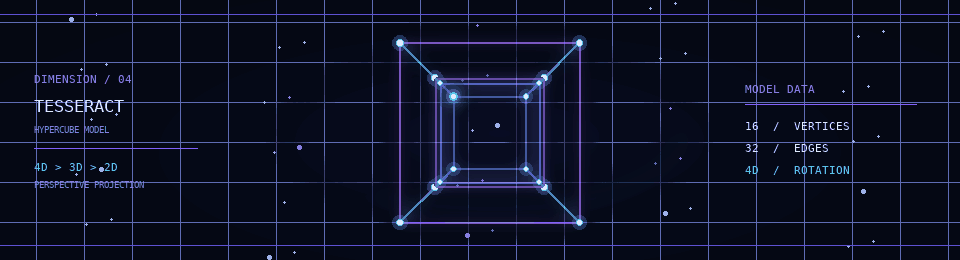

<sub><b>4D → 3D → 2D</b> · a rotating tesseract projection · loop rendered for this profile</sub>

<br />

<a href="assets/tesseract-projection.stl">🧊 Open the companion 3D wireframe model</a>

</div>

---

## 00 Start here

This profile is a map of work visible in my public repositories: a localized household-finance web app, a compact Expo task app, and a personal Hyprland workspace. Each project and technology note links back to its source.

| Jump to | What is inside |
|:--|:--|
| [Identity](#01-identity) | The short version and the kinds of problems I like |
| [Toolchain](#02-toolchain) | Technologies shown in the featured repositories |
| [Project files](#03-project-files) | A guided tour of selected work |
| [System maps](#04-system-maps) | Architecture, domain flow, and the project constellation |
| [Signals](#05-signals) | A source-backed 3D language chart and live GitHub links |
| [Build loop](#06-build-loop) | Principles, learning directions, and how to connect |
| [Rendering notes](#07-rendering-notes) | What the 3D/4D visuals mean—and what GitHub can render |
| [Deep dives](#08-deep-dives) | Data model, security boundaries, state flows, and the theme engine |
| [Interactive site](#09-interactive-site) | Multi-page companion, 3D charts, and the live canvas lab |
| [Visual asset ledger](#10-visual-asset-ledger) | What is static, animated, downloadable, illustrative, or interactive |

---

## 01 Identity

I’m **Ayesh Perera** (`@Ayesh2929`). I enjoy taking an idea from a useful interface down to the data and tooling that make it work. My public work gives me room to move between product UI, mobile app flows, and customizing a Linux desktop.

### The workbench

- **Build for a real routine.** GṛhaLakṣmī focuses on household money management; ToDo keeps its scope deliberately small.
- **Think in complete paths.** A screen is only one part of the experience: navigation, persistence, API boundaries, and clear feedback matter too.
- **Make the system legible.** Prefer names, structure, and documentation that help the next person understand what happens.
- **Stay curious across layers.** Product code, local development tools, and visual experiments can all teach useful systems thinking.

<details>
<summary><b>Open the short dossier</b></summary>

```text
HANDLE       @Ayesh2929
NAME         Ayesh Perera
PUBLIC WORK  Web · mobile · Linux desktop tooling
CURRENT MODE Learn → build → test → refine
SIGNAL RULE  Project-backed tools, no mastery scores
```

</details>

---

## 02 Toolchain

These are technologies documented in or detected from the featured repositories. Version numbers follow checked-in package manifests where available; some older project README badges may be stale. The list describes projects—not a proficiency score.

| Surface | Technologies in the repository | Example |
|:--|:--|:--|
| **Web product** | React 19.2, TypeScript 5.9, Vite 7, Tailwind CSS 4, Recharts 3, Express 4, Node.js 20, PostgreSQL 14+ | [GṛhaLakṣmī](https://github.com/Ayesh2929/GrhaLaksmi) |
| **Mobile app** | React Native 0.79, Expo SDK 53, TypeScript 5.8, Expo Router, AsyncStorage dependency | [ToDo](https://github.com/Ayesh2929/ToDo) |
| **Linux workspace** | Hyprland, Shell, Lua, Python, Neovim | [ASH-HYPRLAND](https://github.com/Ayesh2929/ASH-HYPRLAND) |
| **Learning lab** | GitHub Skills, Copilot Spaces | [Institutional knowledge exercise](https://github.com/Ayesh2929/skills-scale-institutional-knowledge-using-copilot-spaces) |

<details>
<summary><b>Stack badges</b></summary>

<br />

<div align="center">


</div>

</details>

---

## 03 Project files

<table>
  <thead>
    <tr>
      <th align="left">Project</th>
      <th align="left">What it does</th>
      <th align="left">Inside the repo</th>
    </tr>
  </thead>
  <tbody>
    <tr>
      <td valign="top"><a href="https://github.com/Ayesh2929/GrhaLaksmi"><b>GṛhaLakṣmī</b></a><br /><sub>Household finance</sub></td>
      <td valign="top">A household-finance manager designed around local family needs: income, expenses, budgets, savings goals, recurring transactions, bills, loans, accounts, and activity history. The UI documents English and Sinhala support.</td>
      <td valign="top"><code>React 19.2</code><br /><code>TypeScript 5.9</code><br /><code>Vite 7 · Tailwind 4</code><br /><code>Express 4 · Node 20</code><br /><code>PostgreSQL 14+ · Recharts 3</code></td>
    </tr>
    <tr>
      <td valign="top"><a href="https://github.com/Ayesh2929/ToDo"><b>ToDo</b></a><br /><sub>Mobile task app</sub></td>
      <td valign="top">A compact Expo / React Native UI experiment with sign-in/sign-up forms and a task-entry screen. The current task handler accepts non-empty text into component state; authentication and durable storage are still scaffolding.</td>
      <td valign="top"><code>React Native 0.79.6</code><br /><code>Expo SDK 53</code><br /><code>TypeScript 5.8</code><br /><code>Expo Router</code><br /><code>AsyncStorage dependency</code></td>
    </tr>
    <tr>
      <td valign="top"><a href="https://github.com/Ayesh2929/ASH-HYPRLAND"><b>ASH-HYPRLAND</b></a><br /><sub>Linux workspace</sub></td>
      <td valign="top">A personal Hyprland desktop and dotfiles workspace: a place to shape the daily development environment, shell workflow, editor setup, and supporting automation.</td>
      <td valign="top"><code>Hyprland</code><br /><code>Shell / Fish</code><br /><code>Lua</code><br /><code>Python</code><br /><code>Neovim</code></td>
    </tr>
  </tbody>
</table>

<details>
<summary><b>One more learning thread</b></summary>

The [Copilot Spaces exercise](https://github.com/Ayesh2929/skills-scale-institutional-knowledge-using-copilot-spaces) is a GitHub Skills repository focused on scaling institutional knowledge with Spaces.

</details>

---

## 04 System maps

### GṛhaLakṣmī · application architecture

A compact map of the stack described in the project documentation. The frontend talks to the backend through a REST API; protected requests use JWT authentication, and PostgreSQL stores application data.

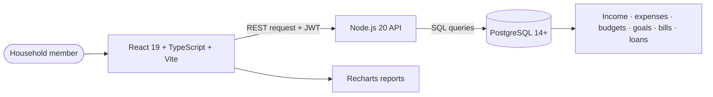

### Three surfaces · one project constellation

The projects are independent repositories; this diagram groups them by the kind of experience they explore.

<div align="center">

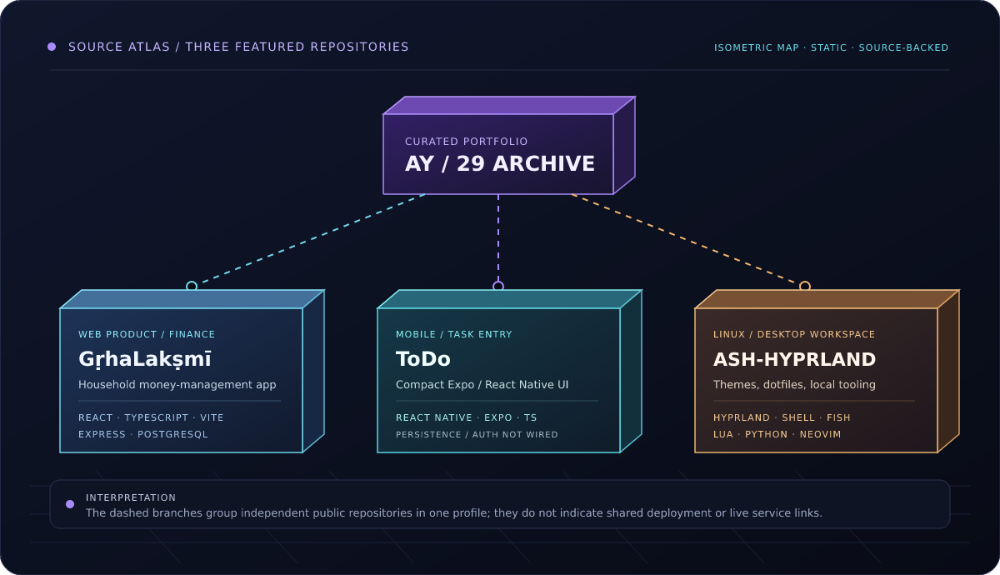

<sub><a href="assets/project-constellation-3d.png">Open full-size map</a> · <a href="assets/project-constellation-3d.svg">SVG source</a> · dashed branches group repositories; they are not APIs or deployed service connections.</sub>

</div>

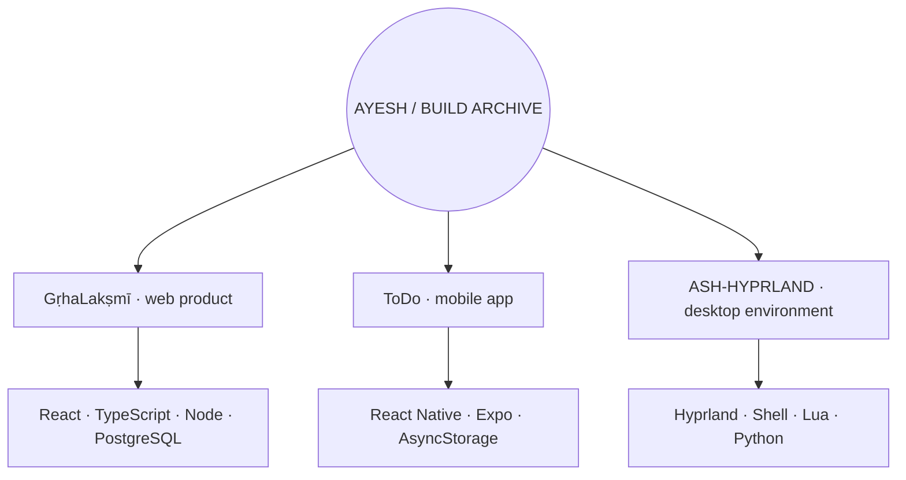

### A data path, from tap to stored record

<div align="center">

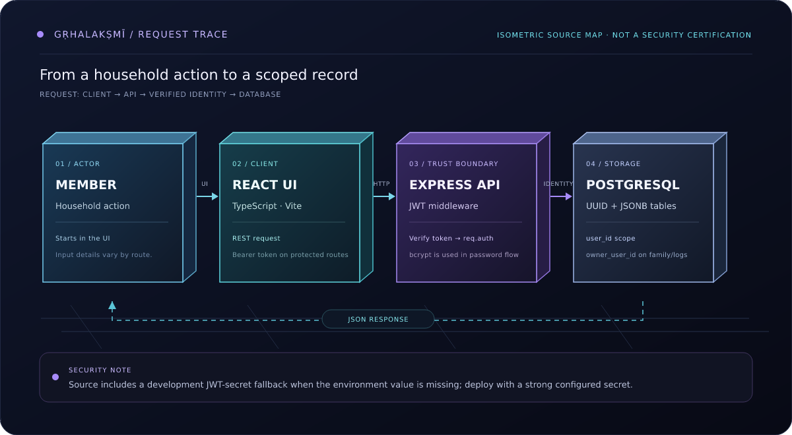

<sub><a href="assets/transaction-boundary-3d.png">Open full-size request map</a> · <a href="assets/transaction-boundary-3d.svg">Editable SVG source</a> · diagram illustrates source flow, not a security certification.</sub>

</div>

<details>
<summary><b>Open the sequence-diagram source</b></summary>

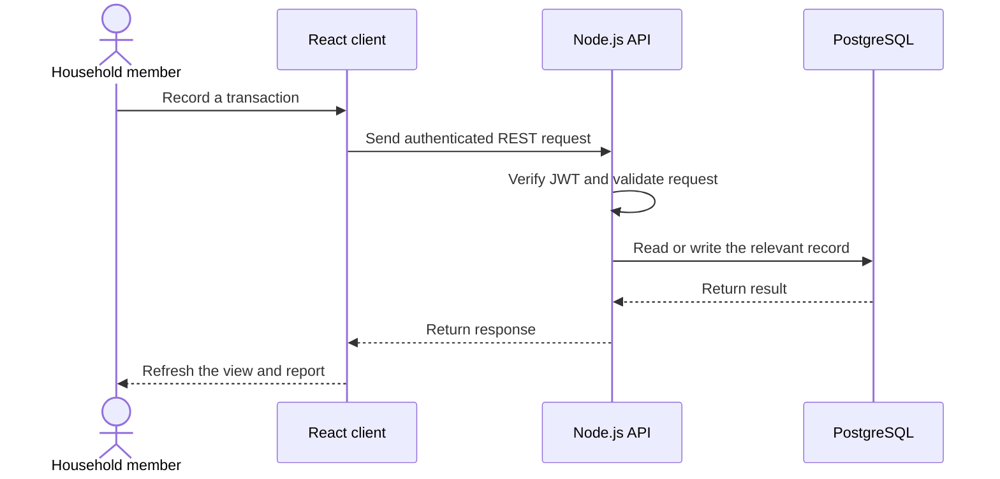

</details>

---

## 05 Signals

### Language footprint · 3D isometric chart

The isometric bars are authored as a local SVG and embedded as a PNG preview for reliable GitHub rendering. Each prism's height is still an honest integer count: whether GitHub Linguist detects a language in the **three featured repositories**. It is not a line-count chart, time-spent chart, or skill rating.

<div align="center">

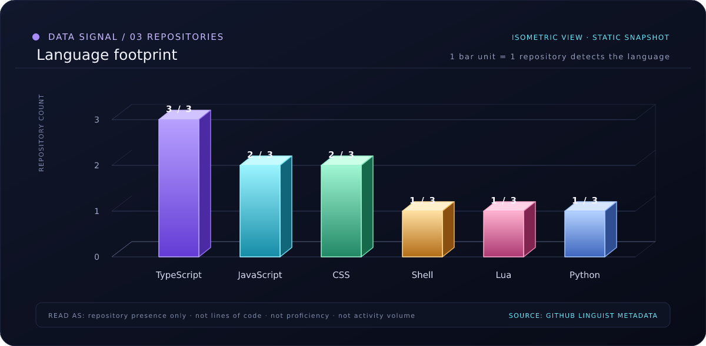

<sub>Static isometric render; every bar is an auditable repository count · <a href="assets/language-footprint-3d.png">open full size</a> · <a href="assets/language-footprint-3d.svg">SVG source</a>.</sub>

</div>

| Language | Repositories with detected presence |
|:--|--:|
| TypeScript | 3 / 3 |
| JavaScript | 2 / 3 |
| CSS | 2 / 3 |
| Shell | 1 / 3 |
| Lua | 1 / 3 |
| Python | 1 / 3 |

<sub>Source: GitHub's public language metadata for GṛhaLakṣmī, ToDo, and ASH-HYPRLAND · checked 2026-10-13. One repository contributes at most one count per language.</sub>

<details>
<summary><b>Counting rules and provenance</b></summary>

- Each value is a binary presence test per repository: detected means `1`, not detected means `0`.
- The total is the sum across GṛhaLakṣmī, ToDo, and ASH-HYPRLAND only; it is not the language share of the entire GitHub account.
- The chart is a versioned local SVG snapshot. For current repository contents, consult GitHub's [repository list](https://github.com/Ayesh2929?tab=repositories) and the linked project sources.
- Contribution activity and current profile totals belong to GitHub's live profile pages. The chart itself is local; the small cover badges are external status badges, not activity charts.

</details>

<div align="center">

<a href="https://github.com/Ayesh2929?tab=overview">Open live GitHub activity</a>
&nbsp;·&nbsp;
<a href="https://github.com/Ayesh2929?tab=repositories">Browse all repositories</a>

</div>

---

## 06 Build loop

### From question to iteration

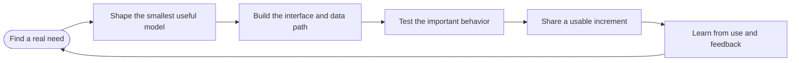

### Things I keep learning

- **Product engineering:** small, understandable features and clear data boundaries.
- **Localization and accessibility:** making interfaces easier to use across languages, devices, and accessibility needs.
- **Cross-platform UI:** keeping mobile experiences responsive and predictable.
- **Linux tooling:** reducing repetitive setup through maintainable configuration and automation.
- **Visual systems:** using diagrams and procedural graphics to make hidden structure easier to see.

### Connect

The best starting point is the [project archive](https://github.com/Ayesh2929?tab=repositories). If a specific project or idea catches your eye, open an issue in that repository or reach me through [GitHub](https://github.com/Ayesh2929).

---

## 07 Rendering notes

GitHub sanitizes profile Markdown: it does not run custom JavaScript, WebGL, canvas apps, or embedded iframes inside a README. This document uses a **pre-rendered 3D hero**, a **locally stored looping tesseract animation**, Mermaid diagrams, and a linked STL mesh instead of pretending the README itself is interactive. The repository now also contains a Pages-ready, multi-page companion site with an actual draggable canvas projection.

The animated geometry is a mathematical visualization: a rotating **4D hypercube (tesseract)** is perspective-projected into 3D, then rendered onto a 2D image. The linked STL is a 3D wireframe projection you can open separately in a compatible model viewer.

### 3D scene atlas · illustrative render

<div align="center">


<sub>Locally stored artwork for the visual direction. It is not a product screenshot or telemetry; use the isometric SVG chart above for the actual repository counts.</sub>

</div>

### Model and animation ledger

| Layer | Concrete artifact | What it represents |
|:--|:--|:--|
| **Character / scene** | [`assets/profile-hero.jpg`](assets/profile-hero.jpg) and [`assets/readme-system-atlas.jpg`](assets/readme-system-atlas.jpg) | Pre-rendered 3D-style profile artwork; illustrative, not a live app capture |
| **Animated object** | [`assets/tesseract-loop.gif`](assets/tesseract-loop.gif) | 40-frame rendered loop of a rotating projected hypercube |
| **Downloadable model** | [`assets/tesseract-projection.stl`](assets/tesseract-projection.stl) | Static triangular mesh of a 3D projection; open it in an STL-compatible viewer |
| **3D data chart** | [PNG preview](assets/language-footprint-3d.png) · [editable SVG source](assets/language-footprint-3d.svg) | Isometric bars for the sourced language-presence counts in section 05 |
| **3D architecture map** | [PNG preview](assets/project-constellation-3d.png) · [editable SVG source](assets/project-constellation-3d.svg) | Source-backed grouping of repositories; not a deployment or runtime topology |
| **3D request boundary** | [PNG preview](assets/transaction-boundary-3d.png) · [editable SVG source](assets/transaction-boundary-3d.svg) | Request/response path, JWT middleware, and owner scoping from project source |
| **Interactive scene** | [`lab/index.html`](lab/index.html) + [`assets/site.js`](assets/site.js) | Pointer/keyboard canvas lab on the companion site; GitHub README cannot run it |

<details>
<summary><b>Projection recipe</b></summary>

```text
rotate in 4D planes: XY → ZW → XW → YZ
                         ↓
             perspective projection 4D → 3D
                         ↓
             camera projection 3D → 2D
                         ↓
                 looping GIF + STL mesh
```

The artwork and animation are stored in [`assets/`](assets/), so they remain versioned with the profile and do not rely on an external animation host.

</details>

---

## 08 Deep dives

The maps below are based on repository source and documentation. They separate visible implementation from planned or incomplete edges—no benchmark numbers or production claims are implied.

<details>
<summary><b>Below the surface · implementation truth table</b></summary>

| Repository | Confirmed in source/tree | Boundary that stays explicit |
|:--|:--|:--|
| [GṛhaLakṣmī](https://github.com/Ayesh2929/GrhaLaksmi) | PostgreSQL migrations; UUID-backed finance resources; bcrypt/JWT auth flow; user-scoped API operations | `JWT_SECRET` has a known development fallback when unset; production must inject a strong secret. This is a code review note, not a security certification. |
| [ToDo](https://github.com/Ayesh2929/ToDo) | A non-empty trimmed task is appended to component state and the entry field is cleared | Current screen does not render the task list; AsyncStorage helper is a stub and is not called; auth forms have no connected API handler. |
| [ASH-HYPRLAND](https://github.com/Ayesh2929/ASH-HYPRLAND) | Separate color/palette, template, hot-reload, and IPC modules; documented OKLCH and contrast-oriented work | The diagram is a source-tree map, not a runtime benchmark, guarantee, or integration test. |
| [Copilot Spaces exercise](https://github.com/Ayesh2929/skills-scale-institutional-knowledge-using-copilot-spaces) | GitHub Skills learning repository about organizing institutional knowledge with Spaces | It is documented as a learning exercise, not a production service or portfolio application. |

</details>

<details>
<summary><b>GṛhaLakṣmī · data ownership and relational model</b></summary>

The migration creates one `users` table and user-owned finance resources. Most resources keep their flexible fields in a `JSONB data` column while the identifier, owner, and timestamps stay relational. `family_members` and `activity_logs` use an explicit `owner_user_id` boundary.

Source: [`backend/src/migrate.js`](https://github.com/Ayesh2929/GrhaLaksmi/blob/main/backend/src/migrate.js)

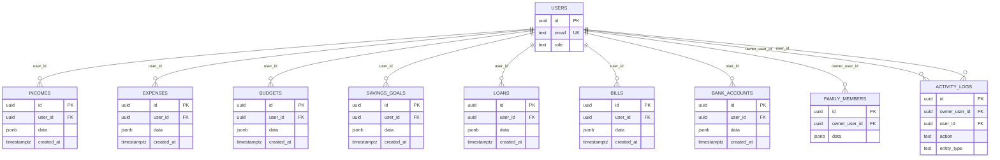

</details>

<details>
<summary><b>GṛhaLakṣmī · ownership columns at a glance</b></summary>

| Resource family | Ownership column(s) in the migration | Reading the boundary |
|:--|:--|:--|
| `incomes`, `expenses`, `budgets`, `savings_goals` | `user_id` | User-owned financial records with flexible `JSONB data` payloads |
| `loans`, `bills`, `bank_accounts` | `user_id` | Separate resource tables with relational identity/ownership and JSONB fields |
| `family_members` | `owner_user_id` | Household ownership is represented explicitly |
| `activity_logs` | `owner_user_id`, `user_id` | Log rows retain both the household-owner and user references, plus action/entity metadata |

The columns describe the database model; they do not, by themselves, prove every authorization path. The API handlers also need to scope reads and writes to the authenticated identity, which is why the request-flow dossier below links the server source.

Source: [`backend/src/migrate.js`](https://github.com/Ayesh2929/GrhaLaksmi/blob/main/backend/src/migrate.js)

</details>

<details>
<summary><b>GṛhaLakṣmī · authentication and request boundary</b></summary>

The backend source shows bcryptjs password hashing/comparison, JWT issuance, and authenticated resource routes. The resource handlers scope finance reads and writes to the authenticated `user_id`; family and activity records use the household owner column.

**Deployment caution:** [`auth.js`](https://github.com/Ayesh2929/GrhaLaksmi/blob/main/backend/src/auth.js) currently falls back to a known development JWT secret when `JWT_SECRET` is unset. A real deployment must provide a strong secret through its environment; the diagram describes code flow, not a security certification.

Sources: [`server.js`](https://github.com/Ayesh2929/GrhaLaksmi/blob/main/backend/src/server.js) · [`auth.js`](https://github.com/Ayesh2929/GrhaLaksmi/blob/main/backend/src/auth.js)

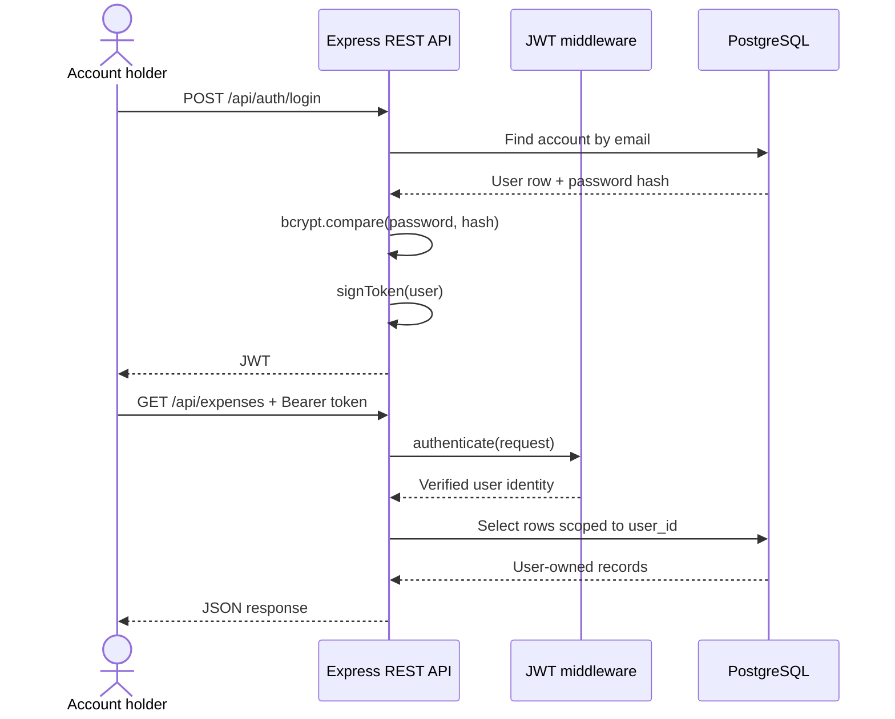

</details>

<details>
<summary><b>ToDo · actual task-state lifecycle</b></summary>

The source currently adds a trimmed, non-empty task to component state and clears the input; the task list itself is not rendered in the current screen. The AsyncStorage package is present, but the `storeData` helper is a stub; authentication UI is not connected to an API yet.

Sources: [`Home.tsx`](https://github.com/Ayesh2929/ToDo/blob/main/Home.tsx) · [`SignIn.tsx`](https://github.com/Ayesh2929/ToDo/blob/main/SignIn.tsx)

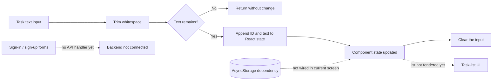

</details>

<details>
<summary><b>ASH-HYPRLAND · theme-generation pipeline</b></summary>

The repository contains separate color, template, hot-reload, and IPC modules. This map summarizes the documented theme workflow and the corresponding engine/template layout; it is a repository map, not a performance claim.

Source tree: [`ash-cli/engines`](https://github.com/Ayesh2929/ASH-HYPRLAND/tree/main/ash-cli/engines) · [`color templates`](https://github.com/Ayesh2929/ASH-HYPRLAND/tree/main/ash-cli/engines/color-engine/templates)

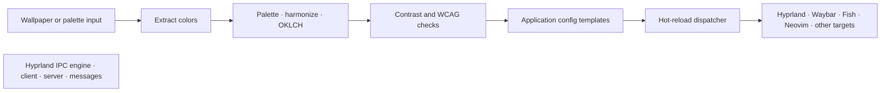

</details>

<details>
<summary><b>4D animation · projection math behind the model</b></summary>

A tesseract has 16 vertices and 32 edges. The loop rotates those vertices through four 4D planes, projects the 4D coordinates into 3D, then applies a camera projection to draw the wireframe in 2D.

```text
V = {−1, +1}⁴                 → 16 vertices
edge(u, v) iff one coordinate differs → 32 edges

rotation planes: XY(t) → ZW(0.71t) → XW(0.47t) → YZ(−0.63t)
4D perspective:  scale₄ = 4.25 / (4.25 − w)
3D camera:       scale₃ = 4.1 / (5.3 − z′)
screen:          (cx + x′·scale₃·67, cy + y′·scale₃·67)
```

The animated GIF contains 40 frames. The companion STL is a static 3D projection mesh with cylindrical edges and vertex nodes; its validated ASCII mesh contains **4,224 triangular facets**. It is a printable/viewable projection of the wireframe, not a volumetric four-dimensional object. [Open or download the STL model](assets/tesseract-projection.stl).

</details>

---

## 09 Interactive site

The repository now contains a real multi-page companion, built with local HTML, CSS, and JavaScript—no npm runtime or third-party script CDN.

| Page | Source file | Experience |
|:--|:--|:--|
| **Home** | [`index.html`](index.html) | 3D-rendered hero art, live tesseract canvas, project constellation, motion controls |
| **Projects** | [`projects/index.html`](projects/index.html) | Source-linked dossiers, implementation notes, interactive isometric language chart |
| **4D Lab** | [`lab/index.html`](lab/index.html) | Pointer/keyboard rotation, four plane sliders, perspective, zoom, motion and reset controls |
| **About** | [`about/index.html`](about/index.html) | Project-backed profile, stack map, principles, learning horizon |
| **Not found** | [`404.html`](404.html) | Branded recovery route with links back into the archive |

The 4D canvas pauses when it leaves view or the browser tab is hidden, caps its pixel density, respects reduced-motion settings, and has keyboard controls. Its source is [`assets/site.js`](assets/site.js); styles live in [`assets/site.css`](assets/site.css).

**Publishing note:** the repository already has a GitHub Actions Pages workflow, but Pages is not enabled in the repository settings yet. To publish the companion site, enable **Settings → Pages → Build and deployment → GitHub Actions**, then run or merge to the workflow’s `main` trigger. Until then, the site source is in the files above and the local preview is available in this session.

---

## 10 Visual asset ledger

A profile README is a static document. This ledger separates the parts GitHub can render directly from the things that need the companion site or an external viewer.

| Artifact | Format / behavior | Evidence and limits |
|:--|:--|:--|
| [`assets/profile-hero.jpg`](assets/profile-hero.jpg) | Static 3D-style illustration | Profile artwork, not a screenshot of a running product |
| [`assets/readme-system-atlas.jpg`](assets/readme-system-atlas.jpg) | Static 3D scene illustration | Decorative character/object scene; do not read its stylized bars as measured data |
| [`assets/tesseract-loop.gif`](assets/tesseract-loop.gif) | 40-frame animated image | Pre-rendered geometry; the README displays frames but does not execute the animation code |
| [`assets/tesseract-projection.stl`](assets/tesseract-projection.stl) | Downloadable triangular mesh | 4,224 facets in the validated STL; view or edit in a compatible model viewer |
| [3D chart PNG](assets/language-footprint-3d.png) · [SVG source](assets/language-footprint-3d.svg) | Static isometric chart | The numeric counts are the sourced language-presence snapshot; not proficiency or code volume |
| [3D source-map PNG](assets/project-constellation-3d.png) · [SVG source](assets/project-constellation-3d.svg) | Static isometric source map | The branches group separate repositories; they are not network calls or a deployment topology |
| [3D request-map PNG](assets/transaction-boundary-3d.png) · [SVG source](assets/transaction-boundary-3d.svg) | Static isometric API/data-boundary map | Summarizes documented authentication and user-scoped database operations; not a security certification |
| [`lab/index.html`](lab/index.html) | Interactive companion page | Canvas rotation and controls execute on the site, not inside README Markdown |

No credential values or private tokens are reproduced in this README. Repository links point to public source; implementation caveats are called out rather than hidden behind visual polish.

<div align="center">

<br />

<sub><code>END OF FILE · KEEP BUILDING · AY-29</code></sub>

<br /><br />

<a href="https://github.com/Ayesh2929?tab=repositories">Explore the repositories</a>
&nbsp;·&nbsp;
<a href="https://github.com/Ayesh2929">Follow the work</a>

</div>
