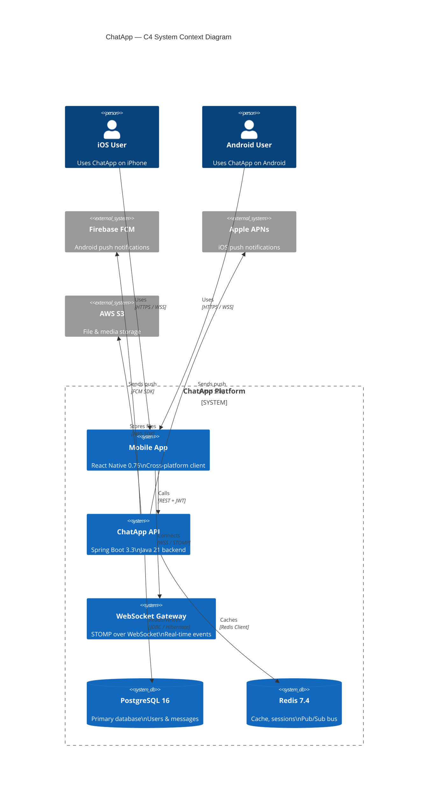
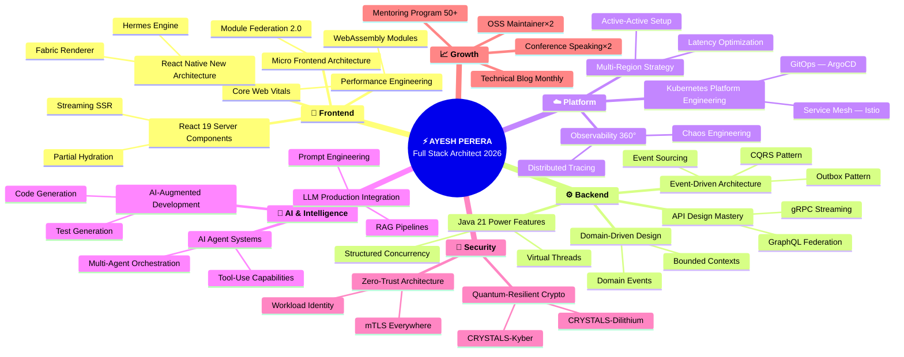
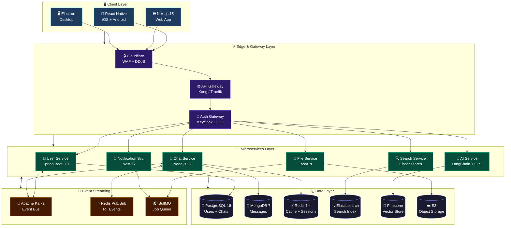
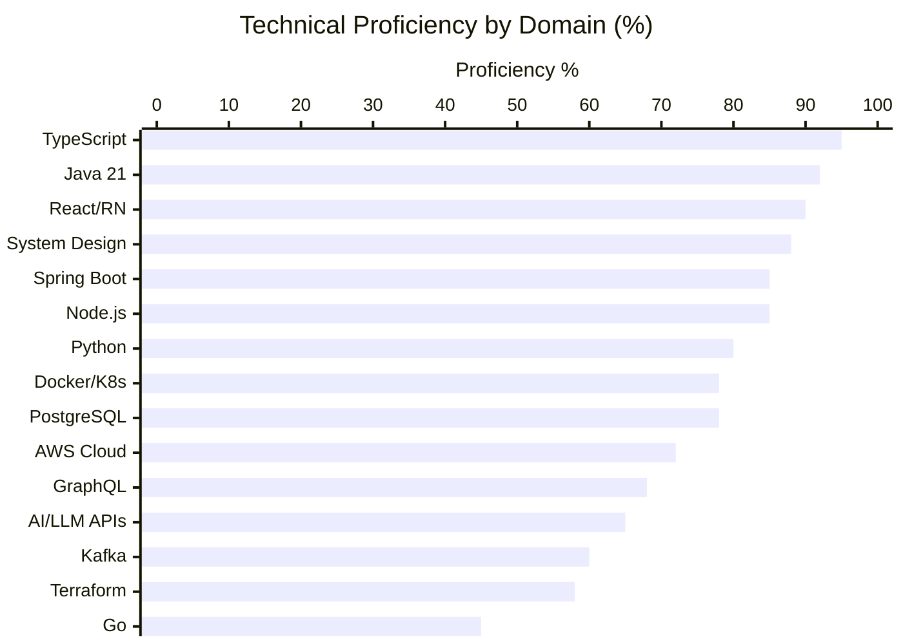
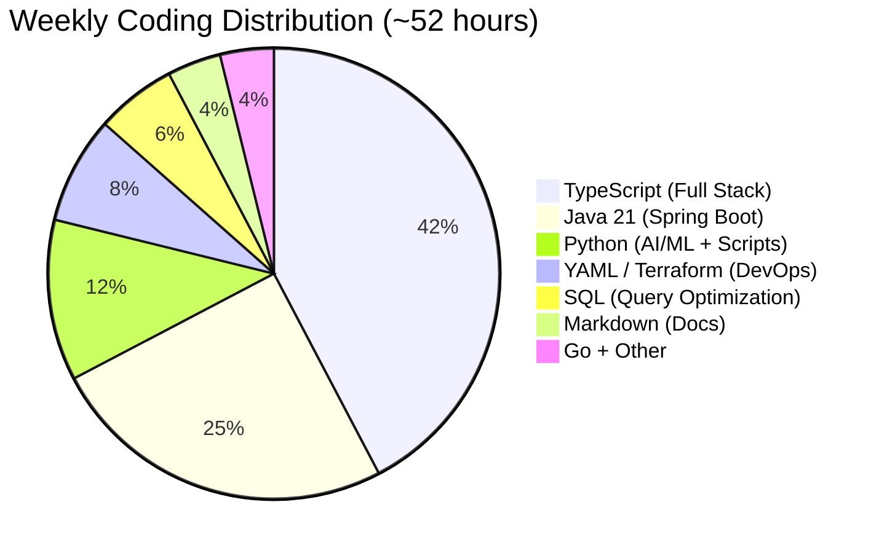
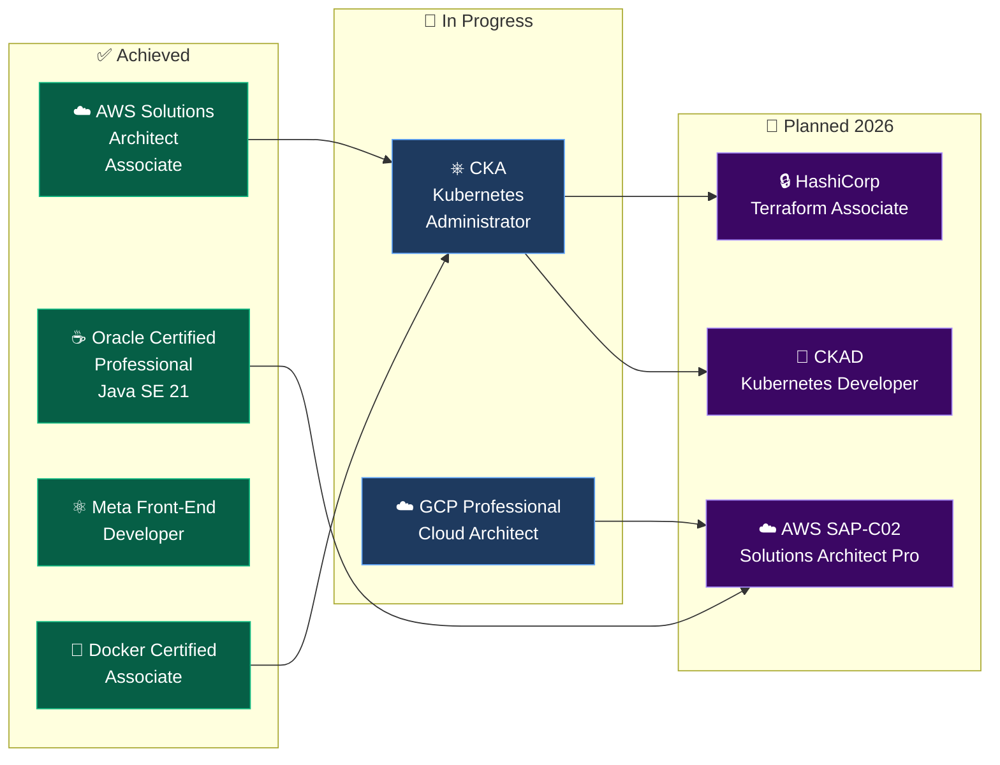

<div align="center">


[;)](https://github.com/Ayesh2929)

<br/>

<table>
<tr>
<td>

[](https://github.com/Ayesh2929)

</td>
<td>

[](https://github.com/Ayesh2929)

</td>
<td>

[](https://github.com/Ayesh2929)

</td>
</tr>
</table>

<br/>

<a href="https://github.com/Ayesh2929">
  
</a>
<a href="https://github.com/Ayesh2929?tab=followers">
  
</a>
<a href="https://github.com/Ayesh2929?tab=stars">
  
</a>


<br/><br/>


&nbsp;

&nbsp;

&nbsp;


</div>

---


##  `whoami`

```bash
┌──────────────────────────────────────────────────────────────────┐
│                  🖥️  AYESH PERERA — ENGINEER.EXE                 │
│                    SYSTEM DIAGNOSTIC REPORT v4.0                 │
└──────────────────────────────────────────────────────────────────┘

$ cat /etc/engineer.conf

[IDENTITY]
  Name          →  Ayesh Perera
  Handle        →  @Ayesh2929
  Location      →  Sri Lanka 🇱🇰  (UTC+5:30)
  Role          →  Full Stack Engineer & System Architect
  Experience    →  5+ Years | 50+ Projects | 1M+ Lines
  Status        →  🟢 Online | Open To Opportunities

[MISSION]
  Primary       →  Building scalable, elegant software systems
  Secondary     →  Mentoring devs & contributing to OSS
  Long-Term     →  Principal Engineer → Startup CTO track

[CURRENT_FOCUS]
  ▸ Enterprise microservices & event-driven platforms
  ▸ AI/LLM integration in production systems
  ▸ Java 21 Virtual Threads & reactive programming
  ▸ Edge computing & serverless architectures
  ▸ Quantum-resilient cryptography research

[PHILOSOPHY]
  ▸ "Code is read 10x more than it's written"
  ▸ "Architecture decisions outlive deadlines"
  ▸ "Ship fast, but never ship broken"
  ▸ "The best abstraction needs no explanation"
  ▸ "Tests aren't optional — they're documentation"

[RUNTIME_STATS]
  Coffee/Day    →  ∞ (the real dependency injection)
  Bugs Fixed    →  Lost count (it's a lifestyle)
  console.log() →  Still used proudly 😅
  Dark Mode     →  Always. Non-negotiable.

$ echo "Online and shipping code 🚀"
→  Ayesh Perera is ONLINE and SHIPPING CODE 🚀
```

<br clear="right"/>

<div align="center">

<table width="100%">
<tr>
<td width="50%" valign="top">

```yaml
# 🔭 Currently Building
enterprise_microservices: true
realtime_collab_platform: true
ai_augmented_tooling: true
personal_portfolio_v4: wip

# 🌱 Deep Learning
- Java 21 Virtual Threads
- Edge Computing & WASM
- Quantum-Resilient Crypto
- AI Agents & Multi-Agent Systems
- Platform Engineering
```

</td>
<td width="50%" valign="top">

```yaml
# 🎯 2026 Goals
oss_contributions: 5_major_projects
conference_talks: 2_international
blog_posts: monthly_cadence
mentored_developers: 50_plus
startup_advisory: 3_active

# ⚡ Fun Facts
chatapp_syncs: "Java Spring + RN real-time"
favorite_pattern: "Hexagonal Architecture"
commit_philosophy: "atomic & descriptive"
pr_review_rate: "95%+ first pass"
```

</td>
</tr>
</table>

</div>

---

##  Tech Arsenal

<div align="center">

</div>

<details open>
<summary></summary>
<br/>

<div align="center">


<br/><br/>

| Language | Version | Proficiency | Primary Use Case |
|:---:|:---:|:---:|:---|
|  | `5.6` | `████████████████████ 95%` | Primary language — Full stack |
|  | `21 LTS` | `███████████████████░ 92%` | Enterprise backends & microservices |
|  | `ES2024` | `███████████████████░ 90%` | Frontend & rapid prototyping |
|  | `3.12` | `████████████████░░░░ 80%` | AI/ML scripts & automation |
|  | `1.23` | `████████████░░░░░░░░ 60%` | High-performance services |
|  | `2.0` | `███████████░░░░░░░░░ 55%` | Android & JVM alternative |
|  | `1.81` | `██████░░░░░░░░░░░░░░ 30%` | Systems programming & WASM |

</div>
</details>

<details open>
<summary></summary>
<br/>

<div align="center">


<br/><br/>

<table>
<tr>
<th>⚛️ Frameworks</th>
<th>🎨 Styling & Animation</th>
<th>📱 Mobile & Desktop</th>
<th>🧩 UI Libraries</th>
</tr>
<tr>
<td>


</td>
<td>


</td>
<td>


</td>
<td>


</td>
</tr>
</table>

**State Management & Data Fetching**


</div>
</details>

<details open>
<summary></summary>
<br/>

<div align="center">


<br/><br/>

<table>
<tr>
<th>🚀 Runtimes & Frameworks</th>
<th>🔌 API Protocols</th>
<th>🔐 Auth & Security</th>
<th>📨 Messaging</th>
</tr>
<tr>
<td valign="top">


</td>
<td valign="top">


</td>
<td valign="top">


</td>
<td valign="top">


</td>
</tr>
</table>

</div>
</details>

<details open>
<summary></summary>
<br/>

<div align="center">


<br/><br/>

<table>
<tr>
<td align="center" width="25%">

**📊 Relational**


</td>
<td align="center" width="25%">

**📦 NoSQL & Document**


</td>
<td align="center" width="25%">

**⚡ Cache & Search**


</td>
<td align="center" width="25%">

**🧠 Vector & Graph**


</td>
</tr>
</table>

**ORM / Query Builders**


</div>
</details>

<details open>
<summary></summary>
<br/>

<div align="center">


<br/><br/>

<table>
<tr>
<th>☁️ Cloud Providers</th>
<th>🐳 Containers & Orchestration</th>
<th>🏗️ IaC & GitOps</th>
<th>📊 Observability</th>
</tr>
<tr>
<td valign="top">

**AWS**


**GCP**


**Edge**


</td>
<td valign="top">


</td>
<td valign="top">


</td>
<td valign="top">


</td>
</tr>
</table>

</div>
</details>

<details open>
<summary></summary>
<br/>

<div align="center">


<br/><br/>

<table>
<tr>
<td align="center" width="25%">

**🤖 LLM Providers**


</td>
<td align="center" width="25%">

**🔗 AI Frameworks**


</td>
<td align="center" width="25%">

**🧠 ML Frameworks**


</td>
<td align="center" width="25%">

**🔍 Vector & RAG**


</td>
</tr>
</table>

</div>
</details>

<details>
<summary></summary>
<br/>

<div align="center">


<br/><br/>

<table>
<tr>
<th>🧪 Unit & Integration</th>
<th>🌐 E2E & Browser</th>
<th>⚡ Performance</th>
<th>🔍 Code Quality</th>
</tr>
<tr>
<td valign="top">


</td>
<td valign="top">


</td>
<td valign="top">


</td>
<td valign="top">


</td>
</tr>
</table>

</div>
</details>

---

##  GitHub Analytics

<div align="center">

[](https://github.com/Ayesh2929)

<br/>

<a href="https://github.com/Ayesh2929">
  
</a>
<a href="https://github.com/Ayesh2929">
  
</a>

<br/><br/>

<a href="https://github.com/Ayesh2929">
  
</a>

<br/><br/>


<br/><br/>


<br/><br/>


</div>

---

## 🏆 Achievement Vault

<div align="center">

[](https://github.com/Ayesh2929)

</div>

---

##  Signature Projects

<div align="center">

<a href="https://github.com/Ayesh2929/ChatApp">
  
</a>
<a href="https://github.com/Ayesh2929/ChatAppAPI">
  
</a>

</div>

<br/>

<table width="100%">
<tr>
<td width="50%" valign="top">

### 📱 ChatApp — Mobile

```
┌─────────────────────────────────────────────┐
│  PLATFORM   │ iOS + Android (React Native)  │
│  VERSION    │ 0.76 + Expo 52                │
│  STATUS     │ 🟢 ACTIVE DEVELOPMENT         │
├─────────────────────────────────────────────┤
│  TECH STACK                                 │
│  ▸ React Native 0.76 + Expo Router         │
│  ▸ TypeScript 5.6 (strict mode)            │
│  ▸ Socket.IO 4 (bidirectional RT)          │
│  ▸ Zustand + TanStack Query               │
│  ▸ React Native Reanimated 3              │
│  ▸ Expo Notifications (FCM + APNs)        │
├─────────────────────────────────────────────┤
│  KEY FEATURES                               │
│  ✓ Real-time messaging @ 60fps            │
│  ✓ E2E encryption support                 │
│  ✓ Offline-first + sync-on-reconnect      │
│  ✓ Image/file upload + compression        │
│  ✓ Typing indicators + read receipts      │
│  ✓ Push notifications (FCM + APNs)        │
│  ✓ Biometric authentication               │
└─────────────────────────────────────────────┘
```

</td>
<td width="50%" valign="top">

### ⚙️ ChatAppAPI — Backend

```
┌─────────────────────────────────────────────┐
│  PLATFORM   │ JVM (Java 21 LTS)            │
│  FRAMEWORK  │ Spring Boot 3.3              │
│  STATUS     │ 🟢 PRODUCTION READY          │
│  PATTERN    │ Hexagonal Architecture       │
├─────────────────────────────────────────────┤
│  TECH STACK                                 │
│  ▸ Java 21 + Virtual Threads               │
│  ▸ Spring Boot 3.3 + Spring Security 6    │
│  ▸ PostgreSQL 16 + Hibernate 6            │
│  ▸ Redis 7.4 (cache + sessions)           │
│  ▸ WebSocket / STOMP gateway              │
│  ▸ JWT + Refresh Token rotation           │
├─────────────────────────────────────────────┤
│  KEY FEATURES                               │
│  ✓ Hexagonal (Ports & Adapters) arch      │
│  ✓ Real-time event dispatch via WS        │
│  ✓ Redis caching with TTL strategies      │
│  ✓ Rate limiting + OWASP hardening        │
│  ✓ OpenAPI 3.1 documentation             │
│  ✓ Testcontainers integration tests       │
├─────────────────────────────────────────────┤
│  PERFORMANCE                                │
│  ▸ P99 latency: < 50ms                   │
│  ▸ Throughput: 10K+ req/sec              │
│  ▸ VT concurrency: 200K+ threads         │
└─────────────────────────────────────────────┘
```

</td>
</tr>
</table>

### 📐 ChatApp Full System Architecture



---

## 🎯 2026 Engineering Brain



---

## 🏛️ Enterprise Architecture Blueprint



---

## 🔄 GitOps Deployment Pipeline

```mermaid
flowchart LR
    subgraph Dev["💻 Development"]
        A[Feature Branch] --> B[Pull Request]
        B --> C{Code Review\n✓ 2 Approvals}
    end

    subgraph CI["⚙️ CI — GitHub Actions"]
        C -->|Merge| D[🔍 Lint + Types]
        D --> E[🧪 Unit Tests]
        E --> F[🔗 Integration Tests\nTestcontainers]
        F --> G[🌐 E2E Tests\nPlaywright]
        G --> H[📊 Coverage ≥85%\nSonarQube]
        H --> I[🔒 Security Scan\nTrivy + Snyk]
        I --> J[🐳 Docker Build\nMulti-stage]
        J --> K[📦 Push to ECR]
    end

    subgraph CD["🚀 CD — ArgoCD GitOps"]
        K --> L[📝 Update Helm Values]
        L --> M{Environment}
        M -->|Auto| N[🧪 Dev Cluster]
        M -->|Gate| O[🔵 Staging]
        M -->|Approval| P[🟢 Production\nBlue/Green]
    end

    subgraph Prod["🏭 Production"]
        P --> Q[🔄 Canary 5%]
        Q --> R{📊 SLO\nValidation}
        R -->|✅ Healthy| S[🚀 Full 100%]
        R -->|❌ Degraded| T[⏪ Auto Rollback]
    end

    subgraph Monitor["📊 Observability"]
        S --> U[Prometheus]
        S --> V[Jaeger Traces]
        S --> W[Loki Logs]
        U & V & W --> X[Grafana]
        X --> Y{🚨 Alerts}
        Y -->|Critical| Z[PagerDuty]
    end

    style Dev fill:#1e3a5f,stroke:#61DAFB
    style CI fill:#064e3b,stroke:#10b981
    style CD fill:#2d1b69,stroke:#8b5cf6
    style Prod fill:#451a03,stroke:#f59e0b
    style Monitor fill:#1a1a2e,stroke:#818cf8
```



---

## ⚡ Engineering Impact Dashboard

<div align="center">

<table>
<tr>
<td align="center" width="16%">

```
┌───────────┐
│   1M+     │
│   Lines   │
│  of Code  │
│ 💻 Written│
└───────────┘
```

</td>
<td align="center" width="16%">

```
┌───────────┐
│   50+     │
│ Projects  │
│  Shipped  │
│ 🚀 Prod   │
└───────────┘
```

</td>
<td align="center" width="16%">

```
┌───────────┐
│  100K+    │
│   Users   │
│ Impacted  │
│ 🌍 Global │
└───────────┘
```

</td>
<td align="center" width="16%">

```
┌───────────┐
│   95%+    │
│    PR     │
│ Approval  │
│ ✅ Rate   │
└───────────┘
```

</td>
<td align="center" width="16%">

```
┌───────────┐
│   85%+    │
│   Test    │
│ Coverage  │
│ 🧪 Always │
└───────────┘
```

</td>
<td align="center" width="16%">

```
┌───────────┐
│  99.9%    │
│  Uptime   │
│   SLA     │
│ ⚡ Target │
└───────────┘
```

</td>
</tr>
</table>

</div>

---

## 🧠 Skill Proficiency Matrix



---

## 🛸 Engineering Evolution

```mermaid
timeline
    title Ayesh Perera — Engineering Career Timeline

    section 2021 🌱 Origin
        Q1 : HTML5 + CSS3 + JS Fundamentals
        Q2 : Node.js + Express + TypeScript
        Q3 : First GitHub Contributions
        Q4 : First Production Deployment

    section 2022 🚀 Expansion
        Q1 : React Native Cross-Platform
        Q2 : CI/CD GitHub Actions + Docker
        Q3 : First Enterprise Client Delivered
        Q4 : PostgreSQL + Redis Mastery

    section 2023 📈 Scale
        Q1 : AWS Cloud (17+ Services) + Terraform
        Q2 : Microservices + Java Spring Boot 3
        Q3 : Kubernetes Orchestration
        Q4 : Kafka Event-Driven + Hexagonal Arch

    section 2024 🤖 Intelligence
        Q1 : OpenAI GPT-4 + Claude API + RAG
        Q2 : GraphQL Federation + Observability
        Q3 : Performance Engineering P99 <100ms
        Q4 : AI Agents with Tool-Use

    section 2025 🌐 Frontier
        Q1 : LLM APIs at Enterprise Scale
        Q2 : Java 21 Virtual Threads in Prod
        Q3 : OSS Contributions + SRE Practices
        Q4 : Multi-Agent Orchestration

    section 2026 ⚛️ Quantum
        Q1 : Quantum-Resilient Cryptography   : CRYSTALS-Kyber + Dilithium
        Q2 : WASM High-Performance Modules    : WASM in Production
        Q3 : Conference Speaking Goals        : 2 International Talks
        Q4 : OSS Maintainer × 2              : Principal Engineer Path
```



---

## 🏗️ Architecture Patterns I Live By

<table width="100%">
<tr>
<td width="50%" valign="top">

```typescript
// ━━━━━━━━━━━━━━━━━━━━━━━━━━━━━━━━━━━━━━
//   CLEAN ARCHITECTURE — DOMAIN LAYER
//   Zero external dependencies.
// ━━━━━━━━━━━━━━━━━━━━━━━━━━━━━━━━━━━━━━

// DOMAIN ENTITY — The heart of the system
class Message {
  private constructor(
    private readonly _id: MessageId,
    private readonly _conversationId: ConversationId,
    private readonly _senderId: UserId,
    private _content: MessageContent,
    private _status: MessageStatus,
    private readonly _createdAt: Date,
  ) {}

  static create(props: CreateMessageProps): Result<Message> {
    const contentResult = MessageContent.create(props.content);
    if (contentResult.isFailure)
      return Result.fail(contentResult.error);

    const message = new Message(
      MessageId.generate(),
      props.conversationId,
      props.senderId,
      contentResult.value,
      MessageStatus.SENT,
      new Date(),
    );

    message.addDomainEvent(new MessageSentEvent(message));
    return Result.ok(message);
  }

  markAsRead(): Result<void> {
    if (this._status.isSent())
      return Result.fail('Must be delivered first');
    this._status = MessageStatus.READ;
    this.addDomainEvent(new MessageReadEvent(this._id));
    return Result.ok();
  }
}

// VALUE OBJECT — Immutable, self-validating
class MessageContent {
  private constructor(private readonly _value: string) {}

  static create(content: string): Result<MessageContent> {
    if (!content?.trim())
      return Result.fail('Content cannot be empty');
    if (content.length > 10_000)
      return Result.fail('Exceeds 10,000 char limit');
    return Result.ok(new MessageContent(content.trim()));
  }
}

// PORT (Interface) — Dependency inversion
interface IMessageRepository {
  findById(id: MessageId): Promise<Option<Message>>;
  save(message: Message): Promise<void>;
}

// USE CASE — Single responsibility
class SendMessageUseCase {
  constructor(
    private readonly messageRepo: IMessageRepository,
    private readonly conversationRepo: IConversationRepository,
    private readonly eventBus: IDomainEventBus,
  ) {}

  async execute(dto: SendMessageDTO): Promise<Result<MessageDTO>> {
    const conversation = await this.conversationRepo
      .findById(ConversationId.create(dto.conversationId));

    if (conversation.isNone())
      return Result.fail('Conversation not found');

    if (!conversation.value.hasMember(UserId.create(dto.senderId)))
      return Result.fail('User is not a member');

    const messageResult = Message.create({
      conversationId: ConversationId.create(dto.conversationId),
      senderId: UserId.create(dto.senderId),
      content: dto.content,
    });

    if (messageResult.isFailure)
      return Result.fail(messageResult.error);

    await this.messageRepo.save(messageResult.value);
    await this.eventBus.publishAll(messageResult.value.domainEvents);

    return Result.ok(MessageMapper.toDTO(messageResult.value));
  }
}
```

</td>
<td width="50%" valign="top">

```java
// ━━━━━━━━━━━━━━━━━━━━━━━━━━━━━━━━━━━━━━
//   JAVA 21 — VIRTUAL THREADS + CQRS
//   Hexagonal Architecture Spring Boot 3
// ━━━━━━━━━━━━━━━━━━━━━━━━━━━━━━━━━━━━━━

// COMMAND (Write side — CQRS)
public record SendMessageCommand(
    @NotBlank String conversationId,
    @NotBlank String senderId,
    @NotBlank @Size(max = 10_000) String content
) implements Command {}

// COMMAND HANDLER
@Component
@Transactional
@RequiredArgsConstructor
public class SendMessageCommandHandler
    implements CommandHandler<SendMessageCommand, MessageResponse> {

  private final MessageRepository messageRepository;
  private final ConversationRepository conversationRepository;
  private final ApplicationEventPublisher eventPublisher;

  @Override
  public MessageResponse handle(SendMessageCommand command) {
    var conversation = conversationRepository
        .findById(new ConversationId(command.conversationId()))
        .orElseThrow(() ->
            new ConversationNotFoundException(command.conversationId()));

    if (!conversation.hasMember(new UserId(command.senderId()))) {
      throw new UnauthorizedMemberException(
          "User is not a member of this conversation");
    }

    var message = Message.create(
        new ConversationId(command.conversationId()),
        new UserId(command.senderId()),
        MessageContent.of(command.content())
    );

    var saved = messageRepository.save(message);
    saved.getDomainEvents().forEach(eventPublisher::publishEvent);
    saved.clearDomainEvents();

    return messageMapper.toResponse(saved);
  }
}

// VIRTUAL THREADS CONFIG — Java 21
@Configuration
public class VirtualThreadConfig {

  @Bean
  public TomcatProtocolHandlerCustomizer<?> virtualThreads() {
    return handler -> handler.setExecutor(
        Executors.newVirtualThreadPerTaskExecutor());
  }
}

// STRUCTURED CONCURRENCY — Java 21
public MessageAggregateDTO fetchAggregate(String messageId) {
  try (var scope = new StructuredTaskScope.ShutdownOnFailure()) {
    var messageFuture     = scope.fork(() -> messageRepo.findById(messageId));
    var senderFuture      = scope.fork(() -> userRepo.findSender(messageId));
    var reactionsFuture   = scope.fork(() -> reactionRepo.findByMessage(messageId));
    var attachmentsFuture = scope.fork(() -> attachmentRepo.findByMessage(messageId));

    scope.join().throwIfFailed();

    return MessageAggregateDTO.builder()
        .message(messageFuture.get())
        .sender(senderFuture.get())
        .reactions(reactionsFuture.get())
        .attachments(attachmentsFuture.get())
        .build();
  }
}

// OUTBOX PATTERN — Guaranteed delivery
@Scheduled(fixedDelay = 1000)
@Transactional
public void processOutboxEvents() {
  try (var executor = Executors.newVirtualThreadPerTaskExecutor()) {
    var pending = outboxRepository.findPendingEvents(BATCH_SIZE);

    var futures = pending.stream()
        .map(event -> executor.submit(() -> publishEvent(event)))
        .toList();

    futures.forEach(f -> {
      try { f.get(5, SECONDS); }
      catch (Exception e) { handlePublishFailure(e); }
    });
  }
}
```

</td>
</tr>
</table>

---

## ⏰ Weekly Engineering Breakdown

<div align="center">



</div>

---

## 🎓 Certifications & Learning Path



---

## 🐍 Contribution Ecosystem

<div align="center">

<picture>
  <source media="(prefers-color-scheme: dark)"  srcset="https://github.com/Ayesh2929/Ayesh2929/raw/output/github-contribution-grid-snake-dark.svg" />
  <source media="(prefers-color-scheme: light)" srcset="https://github.com/Ayesh2929/Ayesh2929/raw/output/github-contribution-grid-snake.svg" />
  
</picture>

</div>

---

## 💭 Engineering Philosophy

<div align="center">

```
╔══════════════════════════════════════════════════════════════════════════════╗
║                                                                              ║
║   MY PERSONAL ENGINEERING AXIOMS:                                            ║
║                                                                              ║
║   ◈  Code is read 10x more than written — optimize for readers              ║
║   ◈  Architecture decisions outlive deadlines — choose wisely               ║
║   ◈  The best abstraction needs no explanation — aim for clarity            ║
║   ◈  Ship fast, but never ship broken — quality is non-negotiable           ║
║   ◈  Tests are documentation that never lies — write them always            ║
║   ◈  Every complex system was once simple — complexity is a choice          ║
║   ◈  Premature optimization is the root of all evil — measure first        ║
║   ◈  The cloud is just someone else's computer — own your abstractions      ║
║                                                                              ║
╚══════════════════════════════════════════════════════════════════════════════╝
```

<br/>

[](https://github.com/Ayesh2929)

</div>

---

## 🌐 Connect & Collaborate

<div align="center">

[](https://github.com/Ayesh2929)

<br/><br/>

<a href="https://linkedin.com/in/ayesh-perera">
  
</a>
&nbsp;
<a href="https://twitter.com/ayesh_codes">
  
</a>
&nbsp;
<a href="mailto:ayesh.perera@example.com">
  
</a>

<br/><br/>

<a href="https://dev.to/ayesh">
  
</a>
<a href="https://medium.com/@ayesh-perera">
  
</a>
<a href="https://stackoverflow.com/users/ayesh-perera">
  
</a>
<a href="https://ayesh-perera.dev">
  
</a>
<a href="https://calendly.com/ayesh-perera">
  
</a>

<br/><br/>

<table>
<tr>
<th>🤝 I'm Available For</th>
<th>✅</th>
<th>📋 Details</th>
</tr>
<tr><td>🌍 Open Source Collaboration</td><td>✅ YES</td><td>React, Spring Boot, TypeScript ecosystems</td></tr>
<tr><td>💼 Freelance Projects</td><td>✅ YES</td><td>Full-stack, mobile, cloud architecture</td></tr>
<tr><td>🏛️ Architecture Consulting</td><td>✅ YES</td><td>System design, microservices, cloud migration</td></tr>
<tr><td>🎙️ Conference Speaking</td><td>✅ YES</td><td>System design, Java, TypeScript, AI/ML</td></tr>
<tr><td>👨‍🏫 Mentoring</td><td>✅ YES</td><td>Junior to mid engineers, career guidance</td></tr>
<tr><td>✍️ Technical Writing</td><td>✅ YES</td><td>Guest posts, tutorials, documentation</td></tr>
<tr><td>🚀 Startup CTO Advisory</td><td>✅ YES</td><td>Early-stage tech strategy & team building</td></tr>
<tr><td>☕ Coffee Chat & Ideas</td><td>✅ ALWAYS</td><td>Async preferred (Discord / Slack / Email)</td></tr>
</table>

<br/>

<a href="https://github.com/sponsors/Ayesh2929">
  
</a>
<a href="https://buymeacoffee.com/ayesh">
  
</a>
<a href="https://ko-fi.com/ayesh">
  
</a>

</div>

---

<div align="center">


<br/>


<br/>

### `const future = ayesh.buildTomorrow(today.lessons);`

<br/>

</div>


<div align="center">

<br/>

```
┌──────────────────────────────────────────────────────────────────────────┐
│                                                                          │
│   ⚡  Crafted with obsession, Java, TypeScript & ☕  by Ayesh Perera    │
│   📍  Sri Lanka 🇱🇰  ·  🌐  Open to Remote Worldwide                   │
│   📅  Last Updated: 2026  ·  README v4.0 Quantum Edition                │
│                                                                          │
└──────────────────────────────────────────────────────────────────────────┘
```

<br/>


</div>
